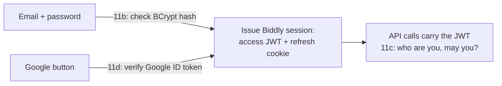

# Challenges

You write the business logic; the boilerplate is ready around it. Each challenge has tests that define "done".
Ask for a hint whenever you are stuck, and ask for a code review when you are finished.

| # | Challenge | Area | Status |
|---|---|---|---|
| 1 | Console auction simulator | JavaScript | ✅ Done (2026-10-27): 11/11 tests, edge cases verified |
| 2 | Create an auction (`AuctionService.createAuction`) | Spring Boot | ✅ Done (2026-10-30): 5/5 unit tests, verified end to end |
| 3 | Search, filter and sort auctions (`filterAuctions`) | TypeScript / React | ✅ Done (2026-11-04): 7/7 tests, exhaustive `never` check |
| 4 | TypeScript domain model (Milestone 2) | TypeScript | Done (2026-10-27) |
| 5 | Publish and cancel an auction (`Auction.publish`, `Auction.cancel`) | Spring Boot / JPA | ✅ Done (2026-11-10): 22/22 backend tests, verified end to end |
| 6 | Edit a draft auction (`AuctionService.updateAuction`, `Auction.updateDetails`) | Spring Boot / JPA | ✅ Done (2026-11-12): 35/35 backend tests, shared validation refactor |
| 7 | Place a bid (`Auction.acceptBid`, `BidService.placeBid`) | Spring Boot / JPA | ✅ Done (2026-11-12): 56/56 backend tests, verified end to end |
| 8 | Concurrent bids: optimistic vs pessimistic locking | Spring Boot / JPA / PostgreSQL | ✅ Done (2026-11-12): 59/59 backend tests, 8-bidder race tests against PostgreSQL |
| 9 | Auction scheduler: start and close auctions on time (`Auction.start`, `Auction.complete`, `AuctionLifecycleService.advance`) | Spring Boot / JPA | ✅ Done (2026-11-13): 81/81 backend tests, 11 dev auctions moved in one live run |
| 10 | Idempotent bids: a retry never places a second bid (`BidService.placeBid`) | Spring Boot / JPA / PostgreSQL | ✅ Done (2026-11-13): 93/93 backend tests, six simultaneous copies give one bid |
| 11a | Register with email and password (`AuthService.register`) | Spring Boot / Spring Security | ✅ Done (2026-11-23): 114/114 backend tests, including four simultaneous sign-ups for one email |
| 11b | Sign in, JWT access token, refresh cookie, sign out (`AuthService.login`, `SessionService.refresh`, `SessionService.logout`) | Spring Boot / Spring Security | ✅ Done (2026-11-24): 142/142 backend tests, including a reused refresh token ending every session |
| 11c | Protect the API: the signed-in user acts, ownership (R1), "My bids" | Spring Boot / Spring Security / React | ⏳ Planned |
| 11d | Sign in with Google (verify Google's ID token) | Spring Boot / OpenID Connect / React | ⏳ Planned |
| 11e | Seller approval: request, admin approves, only approved sellers create auctions | Spring Boot / Spring Security / React | ⏳ Planned |

---

## Challenge 1 - Console auction simulator (JavaScript)

**Folder:** `exercises/01-js-auction-simulator/`
**Run tests:** `cd exercises/01-js-auction-simulator; node --test`

Implement `createAuction`, `placeBid`, `getHighestBid`, `closeAuction` and `getWinner` in `simulator.js`.
These are the same rules the real backend will enforce, so this is a dry run of the bidding engine.

**You will practise:** objects and arrays, immutability (return new objects instead of changing the old ones), `reduce`, throwing errors, and closures (for generating IDs).

Hint 1

`placeBid` should not modify `auction`. Return `{ ...auction, bids: [...auction.bids, newBid], currentPrice: amount }`.

Hint 2

The minimum valid bid is `auction.bids.length === 0 ? auction.startingPrice : auction.currentPrice + auction.minimumIncrement`. Do you agree with that rule? It's one of the open business questions.

**Stretch:** convert it to TypeScript (Milestone 2) and use a *discriminated union* for the auction status.

---

## Challenge 2 - Create an auction (Spring Boot)

**File:** `backend/src/main/java/com/biddly/auction/AuctionService.java` → `createAuction`
**Tests:** `backend/src/test/java/com/biddly/auction/AuctionServiceTest.java` (remove `@Disabled`)
**Run:** `cd backend; .\mvnw.cmd test -Dtest=AuctionServiceTest`

Acceptance criteria:

1. `startTime` in the past → `BusinessRuleException("START_TIME_IN_PAST", ...)`
2. `endTime` not after `startTime` → `BusinessRuleException("INVALID_TIME_WINDOW", ...)`
3. Unknown seller → `ResourceNotFoundException("User", id)`
4. Unknown category, if one is given → `ResourceNotFoundException("Category", id)`
5. Save a **DRAFT** auction whose `currentPrice == startingPrice` and return an `AuctionResponse`.

When it works, the **Sell an item** page in the UI creates real auctions and redirects you to them.

**Questions to answer in your PR description:**

- Why do we validate `endTime > startTime` in the service when the database has a `CHECK` constraint too?
- Why is "now" read from the injected `Clock` instead of `Instant.now()`?
- What does `@Transactional` on `createAuction` give us that the class-level `@Transactional(readOnly = true)` doesn't?
- Should there be a minimum auction duration (for example 1 hour) or a maximum (for example 30 days)? If yes, add a rule and a test.

Hint 1

`userRepository.findById(id)` returns an `Optional<User>`. Look at `.orElseThrow(...)`.

Hint 2

Validate the cheap things (times) **before** hitting the database. The tests check that `save` is never called for invalid input.

Hint 3

`Auction` already has a constructor that sets `status = DRAFT` and `currentPrice = startingPrice`. Use `auctionMapper.toResponse(saved, clock.instant())` to build the response.

---

## Challenge 3 - Search, filter and sort (TypeScript)

**File:** `frontend/src/features/auctions/filterAuctions.ts`
**Tests:** `frontend/src/features/auctions/filterAuctions.test.ts` (change `describe.skip` to `describe`)
**Run:** `cd frontend; npm run test:watch`

The UI controls on the **Live auctions** page already exist but do nothing until you implement this pure function.

**You will practise:** `filter`, `toSorted`, non-mutation, `readonly` arrays, string normalisation, and union types (`AuctionSort`). Can you use `switch` so TypeScript errors if a new sort option is added but not handled? (Look up the `never` exhaustiveness check.)

**Think about it:** this filters on the client, which only works because we load at most 50 auctions. When should filtering move to the server, and what would the API look like?

---

## Challenge 4 - TypeScript domain model (Milestone 2)

**Folder:** `exercises/02-ts-auction-simulator/`
**Run:** `npm install` once, then `npm run check` (type check + tests). Aim for green on both.

In Challenge 1, the *tests* caught your mistakes after you ran the code. Here the *compiler* catches them as you type. The goal isn't "JavaScript with type annotations". It's **making invalid states unrepresentable**: an auction that is closed *and* receiving bids should be impossible to write, not just rejected at runtime.

### Steps

1. **Types first.** Complete the 8 TODOs in `types.ts`. Then `npm run typecheck` will complain that `simulator.ts` is missing, which is expected.
2. **Port the logic.** Copy your `simulator.js` to `simulator.ts`, and add parameter and return types until `npm run typecheck` is happy.
3. **New behaviour the tests require:**
   - `placeBid` accepts only an `OpenAuction`; `closeAuction` turns an `OpenAuction` into a `ClosedAuction`; `getWinner` accepts only a `ClosedAuction`.
   - `closeAuction` stores `winningBid` on the closed auction, so the winner is decided once, at closing time.
   - `isOpen(auction)`: a **type guard** (`auction is OpenAuction`).
   - `tryPlaceBid(...)` returns `Result<OpenAuction, BidRejectedError>` instead of throwing.
   - `parseCreateAuctionInput(value: unknown)` checks untrusted data (like JSON from a request) and returns a `CreateAuctionInput`, or throws an error naming the bad field.
4. Keep the runtime checks (`status !== 'OPEN'` and so on) even though the types forbid those cases. The `untrusted(...)` tests show why.

### You will practise

Literal unions · interfaces vs type aliases · `readonly` / `ReadonlyArray` · discriminated unions and narrowing · utility types (`Pick`) · generics (`Result<T, E>`) · type guards (`x is T`) · `unknown` vs `any` · strict mode · classes under `erasableSyntaxOnly`.

### Questions to answer when you're done

- `parseCreateAuctionInput` takes `unknown`, not `any`. What would `any` let you get away with that `unknown` doesn't?
- `untrusted<T>(value)` uses `as T`. What does `as` actually do at runtime? Why is it dangerous?
- Throwing (`placeBid`) or returning a `Result` (`tryPlaceBid`): which would you use in the React UI, and why?

Hint: TODO 3 (readonly arrays)

`readonly bids: Bid[]` stops `auction.bids = []`, but still allows `auction.bids.push(x)`. You need the array itself to be read-only: `readonly Bid[]` or `ReadonlyArray<Bid>`.

Hint: sharing fields between OpenAuction and ClosedAuction

Put the shared fields in one interface, then `interface OpenAuction extends Shared { readonly status: 'OPEN' }`. An intersection type (`Shared & { ... }`) works too. Look up the difference.

Hint: BidRejectedError won't compile

In JavaScript you wrote `this.code = code` in the constructor. TypeScript needs the field declared on the class first (`readonly code: BidRejectionCode`). The shortcut `constructor(readonly code: ...)` is forbidden by `erasableSyntaxOnly`. Why might it count as "non-erasable"?

Hint: reduce returns the wrong type

`bids.reduce((best, bid) => ..., null)` makes TypeScript think the result is always `null`. Tell it the accumulator type: `bids.reduce<Bid | null>(...)`.

Hint: parseCreateAuctionInput

Narrow step by step: `typeof value === 'object'`, then `value !== null`, then `!Array.isArray(value)`. After that, check each field's `typeof`. Remember `Number.isFinite` from Challenge 1.

---

## Challenge 5 - Publish and cancel an auction (Spring Boot / JPA)

**Files:**

- `backend/src/main/java/com/biddly/auction/Auction.java`: `publish(Instant now)` and `cancel()`
- `backend/src/main/java/com/biddly/auction/AuctionService.java`: `publishAuction(id)` and `cancelAuction(id)`

**Tests:** remove `@Disabled` from `AuctionTest` (entity rules) and from the nested `PublishAndCancel` class in `AuctionServiceTest`.
**Run:** `cd backend; .\mvnw.cmd test -Dtest="AuctionTest,AuctionServiceTest*"`

The endpoints (`POST /api/v1/auctions/{id}/publish` and `/cancel`) and the **Publish** / **Cancel auction** buttons on the details page are ready. Until you finish, the buttons show "This is your backend Challenge 5!".

This time the rules live **on the entity**, not in the service. The service only loads the auction, asks it to change, and returns the result. An `Auction` then protects its own lifecycle: no other code can put it into an invalid status, because there is no `setStatus`.

### Acceptance criteria

`Auction.publish(now)` (rules R15, R16):

1. Not a `DRAFT` -> `BusinessRuleException("AUCTION_NOT_DRAFT", ...)`
2. `endTime` not after `now` -> `BusinessRuleException("AUCTION_ALREADY_ENDED", ...)`
3. `startTime` not after `now` -> `ACTIVE`; otherwise -> `SCHEDULED`

`Auction.cancel()` (rule R17):

1. `COMPLETED` or `CANCELLED` -> `BusinessRuleException("AUCTION_NOT_CANCELLABLE", ...)`
2. Otherwise -> `CANCELLED`

`AuctionService.publishAuction(id)` and `cancelAuction(id)`:

1. Load with `auctionRepository.findById(id)`; unknown id -> `ResourceNotFoundException("Auction", id)`
2. Call the entity method, then return `auctionMapper.toResponse(...)`

When it works, open your draft (auction 8) and click **Publish**. Its end time has already passed, so you should get `AUCTION_ALREADY_ENDED`. Create a new auction, publish it, and it appears on **Live auctions**.

### Learn first

- **Rich domain model vs anemic model:** why `auction.publish(now)` is better than `auction.setStatus(ACTIVE)` called from a service.
- **Encapsulation:** private fields, no setters, methods that keep the object valid.
- **Why** `now` **is a parameter:** entities are created by `new` and by Hibernate, not by Spring, so they can't have the `Clock` injected.
- **JPA dirty checking:** inside a `@Transactional` method, a loaded entity is *managed*. Hibernate notices that you changed a field and writes an `UPDATE` at commit. Do you need to call `save` at all?
- `@Version` **(optimistic locking):** look at the `version` field on `Auction`. What happens if two people publish and cancel the same auction at the same moment?
- **JUnit 5 parameterized tests:** `@ParameterizedTest` with `@EnumSource`, used in `AuctionTest`.
- `@Nested` **test classes** in JUnit 5, used in `AuctionServiceTest`.

### Questions to answer in your PR description

1. You didn't call `auctionRepository.save(...)`, yet the new status is stored. Why? (If you did call it, try removing it.)
2. Why does `publish` take `Instant now` instead of calling `Instant.now()` inside the entity?
3. Why are the publish and cancel endpoints `POST /{id}/publish` rather than `PATCH /{id}` with `{"status": "ACTIVE"}`?
4. A draft whose `startTime` has already passed becomes `ACTIVE` straight away, keeping its old start time. Should publishing move `startTime` to `now` instead? What would bidders see in each case?
5. There's no sign-in yet, so anyone can publish or cancel any auction. Which rule from `business-rules.md` is missing, and which milestone adds it?

Hint 1

The tests reach other statuses with `ReflectionTestUtils.setField(auction, "status", ...)` because there's no setter. In your entity, assign the `status` field directly. You are inside the class.

Hint 2

Check the rules in the order listed. Each test checks that the status is **unchanged** after a rejected call, so throw before you assign anything.

Hint 3

`AuctionService.getById` already shows the "load or 404" pattern with `orElseThrow`. Read "now" once from the `clock` and use the same value for `publish(now)` and `toResponse(auction, now)`.

---

## Challenge 6 - Edit a draft auction (Spring Boot / JPA)

**Files:**

- `backend/src/main/java/com/biddly/auction/Auction.java`: `updateDetails(...)`
- `backend/src/main/java/com/biddly/auction/AuctionService.java`: `updateAuction(id, request)`, plus a small refactor of `createAuction`

**Tests:** remove `@Disabled` from the nested `UpdateDetails` class in `AuctionTest` and the nested `UpdateAuction` class in `AuctionServiceTest`.
**Run:** `cd backend; .\mvnw.cmd test -Dtest="AuctionTest,AuctionServiceTest*"` (stop the running backend first, or restart it afterwards).

Ready for you: `PUT /api/v1/auctions/{id}` with an `UpdateAuctionRequest` body, an **Edit** button on a draft's details page, and an **Edit draft** page that reuses the "Sell an item" form. Until you finish, saving shows "The server can't do this yet".

Sellers make typos. While an auction is a `DRAFT`, nobody can see it or bid on it, so every detail may change. Once it's published, bidders rely on the price rules (R2), so the details lock.

### Acceptance criteria

`Auction.updateDetails(category, title, description, coverImageUrl, startingPrice, minimumIncrement, startTime, endTime)` (rules R2, R18):

1. Not a `DRAFT` -> `BusinessRuleException("AUCTION_NOT_EDITABLE", ...)`, and nothing changes
2. Otherwise copy **every** argument into its field, including `null`s, and set `currentPrice` to the new `startingPrice`

`AuctionService.updateAuction(id, request)`:

1. Load with `auctionRepository.findById(id)`; unknown id -> `ResourceNotFoundException("Auction", id)`
2. The same time rules as create (R14): `START_TIME_IN_PAST`, `INVALID_TIME_WINDOW`
3. If `categoryId` is given, the category must exist -> `ResourceNotFoundException("Category", categoryId)`
4. Call `auction.updateDetails(...)` and return `auctionMapper.toResponse(...)`. No `save`: a test checks that.

**Don't copy steps 2 and 3 from** `createAuction`**.** Move them into private methods, and make both `createAuction` and `updateAuction` call them. The Challenge 2 tests keep passing if the refactor is right.

When it works, open your draft auction 8 ("Shanti Dhara Chandrapbhu Bhagwan"). Its end time passed on 2 November, so publishing it fails with `AUCTION_ALREADY_ENDED`. Click **Edit**, give it new start and end times, save, then publish it. It finally reaches **Live auctions**.

### Learn first

- **PUT vs PATCH:** PUT replaces the whole resource, so a missing optional field means "clear it". PATCH changes only the fields that are sent. Which one does `clearsOptionalFieldsThatAreSentAsNull` test?
- **Extract Method refactoring and DRY:** one rule, one place. What happens later if the time rule changes and it lives in two places?
- **Where each check belongs:** Bean Validation on the request record (shape of one field), the service (needs the clock or the database), the entity (its own state). Sort this challenge's rules into those three.
- **Lost updates and** `@Version`**:** two tabs open the same draft and both save. The second silently overwrites the first. Read how optimistic locking would turn that into an error.
- **Order of checks:** which error is most useful to the user when a request breaks two rules at once?

### Questions to answer in your PR description

1. Which checks did you put in the service and which in the entity, and why?
2. Why would `if (description != null) this.description = description;` be wrong here? For which HTTP method would it be right?
3. Two tabs edit the same draft and both click **Save**. What happens today? What would the client need to send for `@Version` to catch it?
4. Why does `UpdateAuctionRequest` have no `sellerId` and no `status`?
5. Editing resets `currentPrice` to the new `startingPrice`. Why is that safe for a draft but dangerous for an active auction?

Hint 1

Two private methods are enough, for example `validateTimeWindow(Instant start, Instant end, Instant now)` and `findCategory(Long categoryId)`, which returns `null` when the id is `null`. Refactor `createAuction` first and run the Challenge 2 tests before you write `updateAuction`.

Hint 2

The entity check works like `publish`: throw before assigning anything. Inside the class you can assign fields directly (`this.title = title;`).

Hint 3

The service tests freeze time at `NOW`. Read the clock once in `updateAuction` and pass that same instant to the time check and to `toResponse`.

---

## Challenge 7 - Place a bid (Spring Boot / JPA)

**Files:**

- `backend/src/main/java/com/biddly/auction/Auction.java`: `acceptBid(bidder, amount, now)`
- `backend/src/main/java/com/biddly/bid/BidService.java`: `placeBid(auctionId, request)`

**Tests:** remove `@Disabled` from:

- the nested `AcceptBid` class in `AuctionTest` (10 cases)
- the nested `PlaceBid` class in `BidServiceTest` (5 cases)
- `storesAnAcceptedBidAndTheNewPrice` in `BidApiIntegrationTest`

**Run:** `cd backend; .\mvnw.cmd test -Dtest="AuctionTest,BidServiceTest,BidApiIntegrationTest"` (stop the running backend first, or restart it afterwards).

Ready for you:

- **Database:** the `V2__create_bids` migration adds a `bids` table and `auctions.leading_bidder_id`.
- **Data model and API:** the `Bid` entity, `GET` and `POST /api/v1/auctions/{id}/bids`, and `leadingBidder` in every auction response.
- **Details page:** a **Place bid** panel with a "Bid as" picker (sign-in comes in Milestone 5) and a **Bid history** list.

Until you finish, placing a bid shows "The server can't take bids yet".

This is the heart of Biddly. A bid is a request to change the auction's price, and the auction decides whether to accept it.

### Acceptance criteria

`Auction.acceptBid(bidder, amount, now)` checks these rules in this order (R3, R4, R5) and changes nothing when a rule fails:

1. Status is not `ACTIVE`: throw `BusinessRuleException("AUCTION_NOT_ACTIVE", ...)`.
2. `now` is not before `endTime`: throw `AUCTION_CLOSED`. A bid that arrives exactly at the end time is too late.
3. The bidder is the seller: throw `SELF_BIDDING_NOT_ALLOWED`.
4. The amount is below the minimum: throw `BID_TOO_LOW`. With no bids yet, the minimum is `startingPrice`. After that it's `currentPrice + minimumIncrement`.
5. Otherwise set `currentPrice` to the amount and `leadingBidder` to the bidder.

`BidService.placeBid(auctionId, request)`:

1. Load the auction. If the id is unknown, throw `ResourceNotFoundException("Auction", id)`.
2. Load the bidder. If the id is unknown, throw `ResourceNotFoundException("User", id)`.
3. Read `now` once from the `clock`. The server's clock decides when a bid arrived, never the browser's.
4. Call `auction.acceptBid(...)`, then save `new Bid(auction, bidder, amount, now)` and return `bidMapper.toResponse(...)`. A rejected bid must never be saved.

When it works, open live auction 16 ("Selling my iphone", open until 15 November) and bid as Rohan, then as Meera. Try a bid below the minimum, and try bidding as Asha (the seller). Watch the price, the leader and the history update. Then try auction 9: it still says `ACTIVE`, but it ended on 7 November because nothing closes auctions automatically yet (Milestone 7). Your R4 check should reject the bid.

### Learn first

- **Aggregates:** the auction guards its own price, and a `Bid` is a record of what happened. Why is `acceptBid` on `Auction` and not on `Bid`?
- **Entity identity:** two Java objects can represent the same database row. When is `==` on two `User`s true, and when is it false even though they're the same user?
- **Hibernate proxies:** `seller` is `LAZY`, so it may be a proxy subclass. What does `getId()` on a proxy do, and why doesn't it hit the database?
- `BigDecimal` **comparison:** why does `new BigDecimal("1000.0").equals(new BigDecimal("1000.00"))` return `false`? Which method should you use instead?
- **Transactions:** if `bidRepository.save` throws after `acceptBid` changed the price, what happens to the price change?

### Questions to answer in your PR description

1. Why does the order of the checks matter? Give a request that breaks two rules and say which error the user should see.
2. How do you know whether an auction has had a bid yet? Why not compare `currentPrice` with `startingPrice`?
3. Why does `PlaceBidRequest` carry no `placedAt`, even though every bid has a time?
4. Rohan and Meera both bid ₹1,050 on a ₹1,000 auction at the same millisecond. Walk through what happens with your code. (This is Challenge 8.)
5. Once sign-in exists, where should `bidderId` come from instead of the request body, and why?

Hint 1

Write the checks as guard clauses, each one an `if` that throws, in the order listed. The last two lines assign `currentPrice` and `leadingBidder`.

Hint 2

`rejectsTheSellerBiddingOnTheirOwnAuction` passes a different `User` object with the seller's id, just like a separate database load would. Compare ids, not objects. Compare money with `compareTo`, not `equals` or `<`.

Hint 3

`leadingBidder` is `null` until the first accepted bid. That tells you which minimum applies.

---

## Challenge 8 - Concurrent bids (Spring Boot / JPA / PostgreSQL)

**Files:**

- Part 1: `backend/src/main/java/com/biddly/common/GlobalExceptionHandler.java`
- Part 2: `backend/src/main/java/com/biddly/auction/AuctionRepository.java` and `backend/src/main/java/com/biddly/bid/BidService.java`

**Tests:** `BidConcurrencyIntegrationTest` sends 8 real HTTP bids at one auction at the same instant.

- `keepsThePriceAndTheHistoryInAgreement` already passes. Read it first: it proves `@Version` keeps the *data* safe today.
- Remove `@Disabled` from `tellsTheLosersWhatHappenedInsteadOfFailing` after part 1.
- Remove `@Disabled` from `aPessimisticLockMakesBiddersWaitTheirTurn` after part 2.

**Run:** `cd backend; .\mvnw.cmd test -Dtest=BidConcurrencyIntegrationTest` (stop the running backend first, or restart it afterwards).

**How the test forces a race:** races normally depend on luck. The test swaps in a server clock that pauses for half a second, and `placeBid` reads the clock right *after* loading the auction. So all 8 requests have loaded the same version of the auction before any of them can commit.

Ready for you: the bid panel already shows a friendly warning for a `CONCURRENT_UPDATE` error, and refreshes the price after any rejected bid.

### What happens today

Your review answer 4 from Challenge 7, run for real. The first commit wins. The other 7 run `UPDATE auctions ... WHERE version = 0`, change zero rows, and Hibernate throws `ObjectOptimisticLockingFailureException`. Their transactions roll back, bids included. The data is correct, but each loser gets **500 "Something went wrong"**.

### Part 1 - Optimistic locking: answer with 409

In `GlobalExceptionHandler`, handle Spring's `OptimisticLockingFailureException` (package `org.springframework.dao`). Return:

- status **409 Conflict**
- code `CONCURRENT_UPDATE`
- a message a bidder understands, for example "Someone else updated this auction at the same moment. Refresh and try again."

The code is `CONCURRENT_UPDATE`, not `BID_CONFLICT`. The handler is global, so it would also catch two simultaneous edits of a draft.

**Acceptance:** exactly one bid wins. Every other bidder gets 409 `CONCURRENT_UPDATE` or 422 `BID_TOO_LOW`, never a 500, and only one bid row is stored.

### Part 2 - Pessimistic locking: make bidders wait their turn

1. In `AuctionRepository`, add `Optional<Auction> findByIdForUpdate(Long id)`. Annotate it with `@Lock(LockModeType.PESSIMISTIC_WRITE)` and a `@Query` that selects the auction by id. Hibernate then sends `SELECT ... FOR UPDATE`.
2. Use it in `BidService.placeBid` instead of `findById`.
3. `BidServiceTest` mocks `findById`, so 4 of its tests will fail. Update those stubs: mocks are tied to the exact method the code calls.

**Acceptance:** exactly one bid wins and the other 7 get 422 `BID_TOO_LOW`, with **no 409s at all**. Each request waits for the lock, then sees the winner's new price and leader.

When both parts pass, the full suite should be 59/59.

### Learn first

- **Optimistic vs pessimistic:** "detect the collision and fail" vs "prevent the collision by queueing". What does each cost when 2 people bid? When 500 do?
- **What** `@Version` **does in SQL:** watch the `UPDATE` and its `WHERE version = ?`. Why does Hibernate know the update failed?
- `SELECT ... FOR UPDATE` **in PostgreSQL:** which rows does it lock, and until when? What happens to a second transaction that asks for the same row?
- **Transaction boundaries:** the optimistic exception is thrown at **commit**, after `placeBid` has returned. Why can't a `try/catch` inside `placeBid` catch it?
- **Deadlocks and lock timeouts:** what would happen if one transaction locked auction A then B, and another locked B then A?

### Questions to answer in your PR description

1. With optimistic locking only, why did some losers get 409 and none get 422? With the pessimistic lock, why did they all get 422 instead?
2. Why does the 409 handler catch every optimistic-locking failure, and why is a generic `CONCURRENT_UPDATE` code the right name for it?
3. With the pessimistic lock in place, can `@Version` still ever fire on a bid? Should we remove `@Version` from `Auction`? (Think about draft edits.)
4. The lock is held while the transaction runs. Our test clock pauses for 500 ms. What would a slow step inside `placeBid` (for example, sending an email) do to the other bidders? Where should such work go?
5. Which strategy would you pick for Biddly's last 10 seconds of a popular auction, and why? Is retrying a 409 automatically on the server a good idea?

Hint 1

The handler is about 3 lines, like the `BusinessRuleException` handler next to it. `HttpStatus.CONFLICT` is the 409.

Hint 2

Spring Data lets you put `@Lock` on a query method. With JPQL it looks like `@Query("select a from Auction a where a.id = :id")`. Import `Lock` from `org.springframework.data.jpa.repository` and `LockModeType` from `jakarta.persistence`.

Hint 3

If part 2's test still sees 409s, check that `placeBid` really calls the new method, and that the backend you're testing was rebuilt.

---

## Challenge 9 - Auction scheduler (Spring Boot / JPA)

**Why:** today nothing moves an auction forward in time. You published auction 17 with a start time one minute away, and it stayed `SCHEDULED` forever. Ended auctions also stay `ACTIVE` with no winner. This challenge adds the background job that keeps statuses in step with the clock.

**Files:**

- `backend/src/main/java/com/biddly/auction/Auction.java`: implement `start(Instant now)` and `complete(Instant now)`.
- `backend/src/main/java/com/biddly/auction/AuctionLifecycleService.java`: implement `advance()`.

**Ready for you (don't change unless you want to):**

- `AuctionLifecycleJob` calls `advance()` every 5 seconds with `@Scheduled`. It logs what changed. Until you implement `advance()`, it logs one "not implemented" warning and keeps quiet afterwards.
- `SchedulingConfig` turns scheduling on. Both are switched off in the `test` profile, so tests call `advance()` directly and never race a background thread.
- `AuctionRepository` has the two queries you need: `findByStatusAndStartTimeLessThanEqual` and `findByStatusAndEndTimeLessThanEqual`. Read their names: Spring Data builds the SQL from them.
- The bid panel already says "Sold to X for ₹Y", "Closed without bids" or "Bidding opens …", and the price label becomes "Final price" once the auction is `COMPLETED`.

**Tests:** remove `@Disabled("CHALLENGE 9 ...")` from:

- `AuctionTest` nested classes `Start` and `Complete` (entity rules).
- `AuctionLifecycleServiceTest` (service, Mockito).
- `AuctionLifecycleIntegrationTest.movesEveryAuctionToTheRightStateInOneRun` (real PostgreSQL, seven auctions in different states).

**Run:** `cd backend; .\mvnw.cmd test` (this restarts the running backend; start it again afterwards).

### Acceptance criteria

- `start(now)`: only a `SCHEDULED` auction can start (`AUCTION_NOT_SCHEDULED`), and only once its start time has arrived (`START_TIME_NOT_REACHED`). Start time equal to `now` counts as arrived.
- `complete(now)`: only an `ACTIVE` auction can complete (`AUCTION_NOT_ACTIVE`), and only once its end time has arrived (`END_TIME_NOT_REACHED`). End time equal to `now` counts as arrived, which matches R4: a bid at exactly the end time is already rejected.
- Completing keeps `leadingBidder` and `currentPrice` as they are. The leader is the winner (R7). No leader means no winner (R8).
- `advance()` reads the clock **once**, starts every due `SCHEDULED` auction, then completes every ended `ACTIVE` auction, and returns how many of each.
- An auction whose whole window passed while it was still `SCHEDULED` ends up `COMPLETED` in a single run, and counts in both numbers.
- `DRAFT` and `CANCELLED` auctions are never touched.
- After it's done, within 5 seconds of the backend restarting:
  - auction 18 ("Shanti Dhara", start time passed, ends 15 Nov) becomes `ACTIVE`;
  - auctions 10, 11, 12 and 14 (whole window passed while `SCHEDULED`) become `COMPLETED`;
  - the ended seed auctions and auction 9 become `COMPLETED` with no winner.
  - Auction 16 stays `ACTIVE` and completes on 15 Nov with Rohan as the winner.

### Learn first

- `@Scheduled` **and** `@EnableScheduling`**:** `fixedDelay` vs `fixedRate` vs `cron`. Which thread runs the job, and what happens if one run takes longer than the delay?
- **Spring Data derived queries:** how `findByStatusAndStartTimeLessThanEqual` turns into `WHERE status = ? AND start_time <= ?`. Why is it a list, not an `Optional`?
- **Dirty checking inside a transaction:** why `advance()` needs no `save` call for entities it loaded.
- **Hibernate auto-flush:** before running the second query, Hibernate writes pending changes so the query sees them. Why does that matter for an auction that starts and completes in the same run?
- **Testing time-based code:** why the job is off in tests, and why the service takes a `Clock` instead of calling `Instant.now()`.

### Questions to answer in your PR description

1. `advance()` runs in one transaction. If `complete` throws for one auction out of 50, what happens to the other 49? Would one transaction per auction be better? What does it cost?
2. A bid commits at the same moment the job completes that auction. Which one wins, and what does each side see? (Think about `@Version` from Challenge 8.)
3. The job only runs every 5 seconds. Can someone place a bid 3 seconds after the end time, while the auction is still `ACTIVE` in the database? Why not?
4. If we ran two copies of the backend, both would run the job. What could go wrong, and how could you stop it?
5. A single SQL `UPDATE auctions SET status = 'COMPLETED' WHERE status = 'ACTIVE' AND end_time <= now()` would be faster than loading entities. What would you lose by using it?

Hint 1

The two entity methods look like `publish()`: guard clauses that throw `BusinessRuleException`, then one assignment. `complete` doesn't touch the leader at all.

Hint 2

For "has the time arrived", `startTime.isAfter(now)` means *not yet*. For the end, `now.isBefore(endTime)` means *not yet*. Both let equal times through.

Hint 3

In `advance()`, keep the two lists in variables. `forEach(a -> a.start(now))` changes each auction, and `list.size()` gives you the count.

---

## Challenge 10 - Idempotent bids (Spring Boot / JPA / PostgreSQL)

**Why:** a bidder on flaky mobile data presses **Place bid**. The bid reaches the server and is accepted, but the answer never arrives. The app shows "Cannot reach the server", so they press again. Today the second request is judged as a brand-new bid: they get 422 `BID_TOO_LOW` for a bid that actually won, or, with a higher amount, a second bid they never meant to place. An *idempotency key* lets the server recognise "this is the same request again" and answer with the original result.

**File:** `backend/src/main/java/com/biddly/bid/BidService.java`, method `placeBid`. Its Javadoc lists the rules.

**Ready for you (don't change unless you want to):**

- **Database:** migration `V3__add_bid_idempotency_key.sql` adds `bids.idempotency_key` (UUID) with a unique index per bidder.
- `Bid`**:** a new constructor takes the key; `getIdempotencyKey()` reads it.
- `BidRepository.findByBidderIdAndIdempotencyKey`**:** finds the earlier bid for a key.
- `BidController`**:** reads the optional `Idempotency-Key` header and passes it to `placeBid`. A malformed key gets 400 `INVALID_PARAMETER`.
- **Frontend:**
  - every bid attempt sends a fresh UUID;
  - pressing **Place bid** again for the same bidder and amount reuses the key (`nextAttempt` in `features/bids/bidAttempt.ts`);
  - a successful bid starts a new attempt.

**Tests:** remove `@Disabled("CHALLENGE 10 ...")` from:

- `BidServiceTest.Idempotency` (4 tests: the key is stored, a repeat gets the original bid, a different amount or auction is refused).
- `BidIdempotencyIntegrationTest` (3 tests over real HTTP, including six copies of one request arriving together).

Four tests are already enabled and must keep passing: no key means no lookup, keyless bids stay separate, different keys are different bids, and two bidders may use the same key.

**Run:** `cd backend; .\mvnw.cmd test -Dtest="BidServiceTest,BidIdempotencyIntegrationTest"`, then the full suite.

### Acceptance criteria

- No key: `placeBid` behaves exactly as today, and doesn't look anything up.
- This bidder already placed a bid with this key, on this auction, for the same amount: the answer is **201 with that same bid** (same id, same time). Nothing new is stored, and the auction doesn't change. `1000` and `1000.00` are the same amount.
- Same key, but a different auction or amount: 422 `IDEMPOTENCY_KEY_REUSED`, and nothing changes.
- A new key: the bid is judged as today, and the key is stored with it.
- Six copies of one request arriving at the same moment: all six get 201 with the same bid id, and one bid is stored.

### Learn first

- **Idempotency:** what makes `GET` and `PUT` idempotent and `POST` not? How do Stripe and other payment APIs use an `Idempotency-Key` header?
- **Retries are the client's normal case:** a timeout doesn't tell you whether the server did the work. Why can't the client just check first?
- **Read committed in PostgreSQL:** when does one transaction see a row another transaction just inserted? Before or after it commits?
- **Unique indexes as a safety net:** partial unique indexes (`WHERE ... IS NOT NULL`), and what Spring throws when one is violated (`DataIntegrityViolationException`).
- **Spring Data derived queries with** `null`**:** what SQL does `findByBidderIdAndIdempotencyKey(2L, null)` send?

### Questions to answer in your PR description

1. Why does the key lookup have to come after `findByIdForUpdate`? Walk through six copies of one request when it comes before.
2. A bid is rejected with `BID_TOO_LOW`, and the client retries with the same key. What happens, and is that right? What about a bid rejected with `AUCTION_NOT_ACTIVE` on a scheduled auction that starts a second later?
3. Why are keys unique per bidder rather than across all bids? Once sign-in exists, what could a global key let one user do to another?
4. With the lock in place, can the unique index still be violated? When? What does the bidder see today, and what should they see?
5. The key is stored forever on the bid row. Payment APIs usually keep keys for about 24 hours in a separate table or in Redis. What are the trade-offs? Should the header become required?

Hint 1

The whole change is about five lines inside `placeBid`, plus passing the key to the new `Bid` constructor. A replay is just `return bidMapper.toResponse(earlierBid);`.

Hint 2

Compare amounts with `compareTo`, not `equals`: `new BigDecimal("1000").equals(new BigDecimal("1000.00"))` is `false`. For the auction, `earlierBid.getAuction().getId()` gives the id without loading the auction.

Hint 3

If the race test gets 422 `BID_TOO_LOW` for five of the six copies, ask yourself when each copy can first *see* the bid the first copy stored, and what each copy is waiting for before that.

---

## Challenge 11 - Sign-in (plan, Milestone 5)

**Why:** today the browser says who it is. `sellerId` and `bidderId` come from the request body, so anyone can sell or bid as anyone, and anyone can edit anyone's draft. After Challenge 11, the server knows who is calling and decides what they may do.

Users can sign up and sign in **two ways: with an email and a password, or with Google**. Both end the same way: Biddly gives the browser **its own** tokens. After sign-in, the rest of the app doesn't care how you signed in.



Learn the basics first: [authentication primer](learning/authentication-primer.md). Product decisions 7 (Google refuses to take over a password account) and 8 (`USER` and `ADMIN`, with admin-approved sellers) are settled in `business-rules.md`.

Each part gets a full brief, starter code and disabled tests when it starts, like the earlier challenges. This is the outline.

### 11a - Register with email and password

- **You build:** `POST /api/v1/auth/register`. Validate the input, refuse a used email (`409 EMAIL_TAKEN`, R27), hash the password with BCrypt (R28) and create the user.
- **I prepare:** the Spring Security dependency, a security config that still lets everything through (so nothing breaks yet), migration V4 (the `role` column; each later part adds its own columns and tables), the DTOs, a register page in the frontend, and disabled tests. Full brief: [Challenge 11a](#challenge-11a---register-with-email-and-password-spring-boot--spring-security) below.
- **You learn:** why passwords are hashed, not encrypted; salts and the BCrypt work factor; the 72-byte BCrypt limit; why the database's unique index is still needed when the service checks first.

### 11b - Sign in, tokens and sign out

- **You build:** `POST /auth/login` checks the password and issues a session: a **15-minute access JWT** signed by Biddly, plus a **refresh token** (a long random string) in an `HttpOnly` cookie, stored in `refresh_tokens` only as a hash. `POST /auth/refresh` swaps an old refresh token for a new one (rotation). `POST /auth/logout` revokes it. `GET /auth/me` returns the signed-in user.
- **The key design point:** "issue a session for this user" is **one method**. Google sign-in in 11d calls the same method.
- **I prepare:** the JWT signing key from an environment variable (never in Git), the cookie settings, the sign-in page, and a session module in React that keeps the access token in memory. Full brief: [Challenge 11b](#challenge-11b---sign-in-tokens-and-sign-out-spring-boot--spring-security) below.
- **You learn:** what is inside a JWT and why it is signed but not encrypted; why access tokens are short-lived; why the refresh token goes in an `HttpOnly` cookie rather than `localStorage`; rotation and reuse detection.

### 11c - Protect the API

- **You build:** write endpoints need a valid JWT (`401` otherwise, R29). `sellerId` and `bidderId` leave the request bodies; the service takes the signed-in user instead. Only the owner may edit, publish or cancel (`403`, R1). Add **"My bids"** (US-24).
- **I prepare:** the JWT check in the Spring Security filter chain, JSON `401` and `403` answers in the usual `ApiError` shape, the frontend's automatic refresh-and-retry on `401`, protected routes (US-31), and the "Bid as" picker removed.
- **You learn:** the Spring Security filter chain, `SecurityContext` and `@AuthenticationPrincipal`; `401` vs `403`; why trusting ids from the client is the classic "IDOR" bug.

### 11d - Sign in with Google

- **How it works:** the frontend shows Google's **Sign in with Google** button. Google signs the user in and gives the browser an **ID token**, a JWT signed by Google that says who the user is. The frontend posts it to `POST /api/v1/auth/google`. The backend verifies it and then calls 11b's "issue a session" method.
- **You build:** the verification and account rules:
  - **Verify (R30):** Google's signature (public keys from Google's JWKS URL), issuer `https://accounts.google.com`, audience = **our** client ID, not expired, `email_verified` is true.
  - **Find the account by Google's** `sub`, the account ID that never changes. Found: sign in.
  - **Not found, and no account has this email:** create one with the Google name and email, and no password.
  - **Not found, but the email already has a password account:** refuse with `409 ACCOUNT_EXISTS` (R31).
- **I prepare:** the Google button in the frontend, a `GoogleTokenVerifier` interface so tests can use fake tokens signed with a test key instead of calling Google, the configuration (`GOOGLE_CLIENT_ID` from the environment), and step-by-step setup notes for the Google Cloud Console.
- **You set up once:** a Google Cloud project, the OAuth consent screen in testing mode with yourself as a test user, and a "Web application" OAuth client ID with `http://localhost:5180` as an authorised JavaScript origin. This flow needs **no client secret**. The client ID isn't secret, but it still comes from the environment so each environment can use its own.
- **You learn:** OAuth 2.0 vs OpenID Connect; ID tokens vs access tokens; verifying a JWT someone else signed (public keys) vs one you signed yourself; why `sub` and not email identifies a Google user; the account pre-hijacking attack.

### 11e - Seller approval

- **You build (R32):**
  - The seller-status moves on `User`, as guard clauses like `Auction.publish`: request (`NONE` or `REJECTED` → `PENDING`), approve and reject (`PENDING` only).
  - `POST /api/v1/me/seller-request` for the signed-in user.
  - `GET /api/v1/admin/seller-requests` (oldest first) plus approve and reject endpoints, for `ADMIN` only.
  - `createAuction` refuses users who aren't `APPROVED` with `403 SELLER_NOT_APPROVED`.
- **I prepare:**
  - the `seller_status` column, with existing seed sellers set to `APPROVED`;
  - `ADMIN`-only URL rules in the security config;
  - a way to create the first admin without putting credentials in Git: the account whose email matches the `BIDDLY_BOOTSTRAP_ADMIN_EMAIL` environment variable is made `ADMIN` at startup;
  - a "Become a seller" button and status, a small admin page, and **Create auction** shown only to approved sellers.
- **You learn:** role checks (`hasRole("ADMIN")`) vs ownership checks (R1) vs state rules (R32); why the UI hiding a button is not security; how to bootstrap the first admin safely.

**Why Google comes last:** after 11b and 11c the whole session machinery exists, so Google is just "a second way to prove who you are". It also keeps 11a-11c free of any Google setup.

---

## Challenge 11a - Register with email and password (Spring Boot / Spring Security)

**Why:** Biddly has no accounts yet. The demo users came from seed data, and the browser just claims to be one of them. Registration is the first step: an email, a display name, and a password that the server stores safely.

**File:** `backend/src/main/java/com/biddly/auth/AuthService.java`, method `register`. Its Javadoc lists the rules.

**Ready for you (don't change unless you want to):**

- **Spring Security** is added. `configuration/SecurityConfig.java` still lets every request through, so nothing that works today breaks; 11c locks it down. It also provides the `PasswordEncoder` bean (BCrypt, cost 10).
- **Migration V4:** `users.role` (`USER` or `ADMIN`, default `USER`). `User` has a new constructor that takes the password hash, plus `getPasswordHash()` and `getRole()`.
- `UserRepository.existsByEmailIgnoreCase`**.**
- `common.ConflictException(code, message)`, which `GlobalExceptionHandler` turns into **409**. `BusinessRuleException` is still 422.
- `POST /api/v1/auth/register` (`AuthController`) with `RegisterRequest` (name, email and password, checked by Bean Validation) and `AccountResponse` (`AccountResponse.from(user)`; it has no password field at all).
- **Frontend:** a **Create account** link in the header and a register page at `/register`. The form checks the password length in bytes and that the two passwords match (`features/auth/registerForm.ts`, 4 tests). Server errors appear next to the right field: `EMAIL_TAKEN` under the email, `PASSWORD_TOO_LONG` under the password.

**Tests:** remove `@Disabled("CHALLENGE 11a ...")` from:

- `AuthServiceTest` (8 unit tests: a hash and never the password, a different salt each time, lower-case email, trimmed name, role `USER`, `EMAIL_TAKEN`, a lost race, and the 72-byte limit on both sides).
- `AuthApiIntegrationTest` (3 tests over HTTP: create an account, a used email in another letter case, a password that's too long). Its fourth test, Bean Validation, is already enabled and must keep passing.
- `RegistrationRaceIntegrationTest` (four sign-ups for one email at the same moment: one 201, three `409 EMAIL_TAKEN`, one account).

**Run:** `cd backend; .\mvnw.cmd test -Dtest="AuthServiceTest,AuthApiIntegrationTest,RegistrationRaceIntegrationTest"`, then the full suite.

**Try it:** restart the backend (the new library needs a full restart), open <http://localhost:5180/register> and create an account. Then look at what's actually stored:

```powershell
"SELECT id, email, left(password_hash, 7) AS hash_start, length(password_hash) AS hash_length, role FROM users;" | docker exec -i biddly-postgres sh -c 'psql -U "$POSTGRES_USER" -d "$POSTGRES_DB"'
```

### Acceptance criteria

- `201` with the account (`id`, `displayName`, `email`, `role` `USER`, `createdAt`). The response never contains the password or its hash.
- The email is stored in lower case; the display name without spaces around it.
- The stored `password_hash` is a BCrypt hash (it starts with `$2`), and `passwordEncoder.matches(password, hash)` is true.
- An email that already has an account, in any letter case: `409 EMAIL_TAKEN`, and nothing is saved.
- A password over 72 bytes in UTF-8 (for example 25 `₹` signs: 25 characters, 75 bytes): `422 PASSWORD_TOO_LONG`, and nothing is saved.
- Four sign-ups for the same email at the same moment: one `201` and three `409 EMAIL_TAKEN`. Never a `500`.

### Learn first

- **Sections 1-3 of the [authentication primer](learning/authentication-primer.md)**, which you've done.
- `PasswordEncoder`**:** `encode(raw)` gives a new salted hash every time; `matches(raw, hash)` reads the salt back out of the hash. Why can't you just compare `encode(raw)` with the stored hash?
- **Bytes vs characters:** `"₹".length()` is 1 in Java, but `"₹".getBytes(StandardCharsets.UTF_8).length` is 3. What does `BCryptPasswordEncoder.encode` do with more than 72 bytes?
- **Unique index vs check-then-insert:** two requests can both pass `existsByEmailIgnoreCase` before either saves. What does Spring throw when PostgreSQL's unique index then refuses the second insert?
- `toLowerCase(Locale.ROOT)`**:** why not plain `toLowerCase()`? (Look up "Turkish I".)

### Questions to answer in your PR description

1. The unique index already compares `lower(email)`. Why also store the email in lower case?
2. Your service checks whether the email exists before saving. Why is the database's unique index still needed? And why is catching every `DataIntegrityViolationException` as `EMAIL_TAKEN` a little risky?
3. `EMAIL_TAKEN` tells anyone whether an email has a Biddly account, yet sign-in (11b) will say only "Wrong email or password". Is that inconsistent? How do some sites avoid the leak on sign-up?
4. Why count the password limit in bytes rather than characters? What would happen with 25 `₹` signs if you didn't check?
5. `RegisterRequest` overrides `toString()`. Why? Name two other ways a password could end up somewhere it shouldn't.
6. One BCrypt hash takes about 100 ms of CPU. What does that mean for someone sending thousands of requests to `/register`, and what protects the server?

Hint 1

About a dozen lines in this order: normalise the email and name, check the byte length, check the email, hash the password, save, and return `AccountResponse.from(saved)`.

Hint 2

`request.password().getBytes(StandardCharsets.UTF_8).length > 72`. Throw the `BusinessRuleException` before hashing, since hashing is the slow part.

Hint 3

If the race test gets 500s, read the backend log: which exception does `userRepository.save` throw when the unique index refuses the insert? With `IDENTITY` ids, Hibernate sends the `INSERT` immediately inside `save`, so you can catch it right there and throw your `ConflictException` instead.

---

## Challenge 11b - Sign in, tokens and sign out (Spring Boot / Spring Security)

**Why:** after 11a people can create accounts, but nobody can prove they own one. Signing in gives the browser two things: a **15-minute access token** (a JWT that Biddly signs, sent with each request) and a **14-day refresh token** in an `HttpOnly` cookie, which gets a new access token without asking for the password again.

**Files:**

- `backend/src/main/java/com/biddly/auth/AuthService.java`, method `login`.
- `backend/src/main/java/com/biddly/auth/SessionService.java`, methods `refresh` and `logout`.

Their Javadoc lists the rules. Leave `register` as it is.

**Ready for you (don't change unless you want to):**

- **Migration V5:** the `refresh_tokens` table. It holds only the **SHA-256 hash** of each token, plus when it was created, when it expires and when it was revoked. Your dev database already has it.
- `RefreshToken` entity with `isRevoked()`, `isExpired(now)` and `revoke(now)`. `RefreshTokenRepository`:
  - `findByTokenHashForUpdate(hash)` locks the row, so two refreshes with the same token queue up;
  - `revokeAllForUser(userId, now)` ends every session of a user.
- `TokenHasher.sha256(raw)`: hash a token from the cookie this way before you look it up.
- `SessionService.issue(user)`: creates and stores a new refresh token and signs an access token. Password sign-in calls it now; Google sign-in (11d) will call it too.
- `JwtService` **and** `JwtConfig`**:** HS256 signing with the key from `JWT_SECRET`. The key must be at least 32 bytes, or the app refuses to start. Dev and test have their own public, dev-only keys; production has no default.
- `UnauthorizedException` **(401) and** `ForbiddenException` **(403)**, both handled by `GlobalExceptionHandler`. `UserRepository.findByEmailIgnoreCase`.
- `AuthController`**:**
  - `POST /api/v1/auth/login`, `/refresh` and `/logout`;
  - `GET /api/v1/auth/me`, which Spring Security protects: it needs a valid access token;
  - the `biddly_refresh` cookie: `HttpOnly`, `SameSite=Strict`, `Path=/api/v1/auth`, `Secure` outside dev.
- **Dev seed:** Asha, Rohan and Meera now have the demo password `biddly-demo`. It's public on purpose and exists only in the dev seed.
- **Frontend:**
  - a **Sign in** page at `/sign-in`;
  - the header shows your name and **Sign out** once you're signed in;
  - the access token lives only in memory (`lib/accessToken.ts`) and goes out as `Authorization: Bearer ...`;
  - a page load restores the session through the cookie, and the token refreshes itself a minute before it expires;
  - only one refresh runs at a time (`features/auth/session.ts`, 6 tests). Otherwise React's StrictMode would refresh twice, and your reuse detection would sign you out.

**Tests:** remove `@Disabled("CHALLENGE 11b ...")` from:

- `AuthServiceTest.Login` (7 unit tests): the right password starts a session. A wrong password, an unknown email, an account without a password and a 75-byte password all get the same 401. A suspended account gets 403, but only with the right password.
- `SessionServiceTest.Refresh` (5) and `SessionServiceTest.Logout` (2): rotation; a missing, unknown or expired token; a reused token ends every session; sign-out never fails.
- `AuthSessionIntegrationTest` (7 tests over HTTP, with the real cookie and database). Its other 3 tests check `/auth/me` and are already enabled; they must keep passing.

**Run:** `cd backend; .\mvnw.cmd test -Dtest="AuthServiceTest,SessionServiceTest,AuthSessionIntegrationTest"`, then the full suite.

**Try it:** restart the backend (there's a new library), open <http://localhost:5180/sign-in> and sign in as `asha@biddly.dev` with `biddly-demo`. Then:

- In DevTools > Application > Cookies, find `biddly_refresh`. Can you read it from the Console with `document.cookie`?
- Copy the access token from the `/login` response in the Network tab and paste it into <https://jwt.io>. Which claims can you read without the key?
- Reload the page: you stay signed in. Sign out, then reload: you don't.
- See what the database keeps:

```powershell
"SELECT id, user_id, left(token_hash, 12) AS hash_start, expires_at, revoked_at FROM refresh_tokens ORDER BY id;" | docker exec -i biddly-postgres sh -c 'psql -U "$POSTGRES_USER" -d "$POSTGRES_DB"'
```

### Acceptance criteria

- **Sign in:** `200` with `accessToken`, `tokenType` `Bearer`, `expiresAt` and the `account`, plus the `biddly_refresh` cookie. The refresh token is never in the response body.
- The email matches in any letter case.
- **One vague answer:** unknown email, wrong password or an account with no password all get `401 INVALID_CREDENTIALS`, "Wrong email or password.", and no cookie.
- **Suspended:** the right password on a `SUSPENDED` account gets `403 ACCOUNT_SUSPENDED` and no session. A wrong password still gets the vague `401`.
- **Refresh:**
  - `200` with a new access token and a **new** cookie, and the old refresh token never works again;
  - a missing, unknown or expired token gets `401 INVALID_REFRESH_TOKEN`.
- **Reuse:** presenting an already-rotated token gets the same `401` **and** revokes every session of that user, including the newest one. The revocations stay in the database even though the request fails.
- **Sign out:** always `204`, the token is revoked, and the cookie is deleted (`Max-Age=0`), even with no cookie at all.

### Learn first

- **Sections 4 and 5 of the [authentication primer](learning/authentication-primer.md)**, which you've done.
- `PasswordEncoder.matches(raw, hash)`**:** what does it return when the hash is `null`, or the password is over 72 bytes? Try both in a unit test rather than guessing. Only `encode` throws for the length.
- `@Transactional` **rollback rules:** by default a `RuntimeException` rolls back the whole transaction. Read about `noRollbackFor`. Which of your methods writes to the database **and** then throws?
- `Optional`**:** `findByEmailIgnoreCase` and `findByTokenHashForUpdate` return one. Use `orElseThrow` rather than `get()`.
- **Pessimistic locks again (Challenge 8):** why must two refreshes of the same token wait for each other?

### Questions to answer in your PR description

1. Passwords are hashed with slow BCrypt, but refresh tokens with fast SHA-256. Why is that safe for refresh tokens and not for passwords?
2. Your reuse check revokes every session and then throws a 401. What happened to those revocations before you changed the transaction settings, and why?
3. A user has Biddly open in two tabs, and both refresh at the same moment with the same cookie. What happens with your reuse detection? How could a real system avoid signing them out (a short grace period, for example)?
4. An unknown email skips BCrypt, so it answers in about 1 ms, while a wrong password takes about 100 ms. What could an attacker learn from that, and how could you close the gap?
5. `/refresh` uses only the cookie, and the browser sends cookies by itself. What stops another website from calling it (CSRF)? Why does our CSRF protection being switched off not hurt here?
6. Why is the access token kept in memory and sent as a header, rather than put in a cookie too? And what does every backend copy behind the load balancer need to share to accept it?

Hint 1

`login` is about a dozen lines: find the user by email (no user means `INVALID_CREDENTIALS`), check the password with `passwordEncoder.matches`, then check for `SUSPENDED`, then `return sessionService.issue(user)`. Keep the 401 message in one constant so the cases can't drift apart.

Hint 2

`refresh`: `if (raw == null)` throw first, then `findByTokenHashForUpdate(TokenHasher.sha256(raw))`. Check revoked **before** expired: a stolen old token is revoked, and revoked is the case that needs `revokeAllForUser(user.getId(), now)`. Get `now` from `clock.instant()`, as `issue` does, so the tests can fix the time.

Hint 3

If `aReusedRefreshTokenEndsTheWholeSession` gets a `200` for the newest token, your `revokeAllForUser` ran but was rolled back by the 401 you threw afterwards. Tell `@Transactional` which exception should not undo the work: `noRollbackFor = UnauthorizedException.class`.