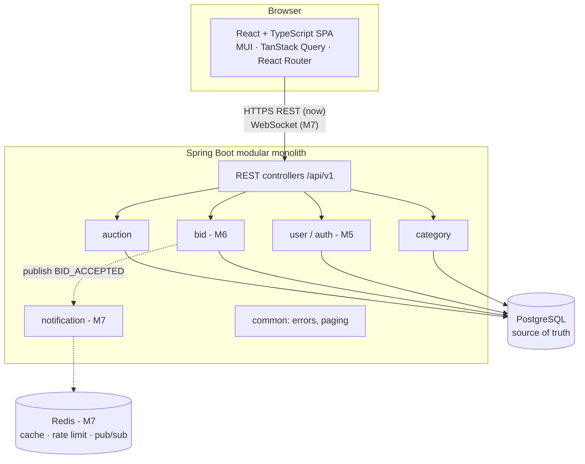
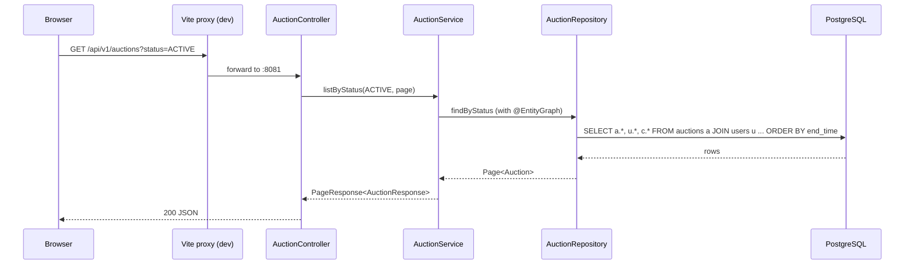
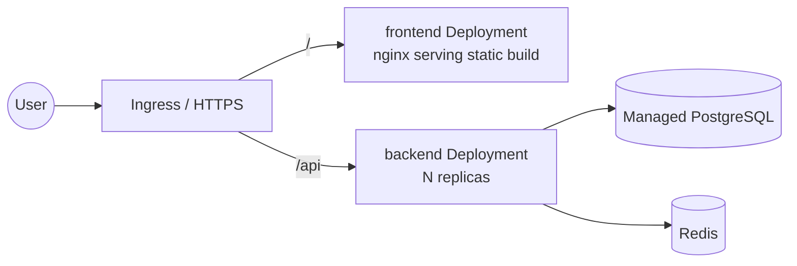

# Architecture

## Style: modular monolith

One Spring Boot application, one PostgreSQL database, with code split into modules by **business capability**. A bid needs one ACID transaction across the auction and bid tables. Inside a monolith that is a single `@Transactional` method; across microservices it would need distributed transactions or sagas. Modules keep the door open to extracting a service later, for example notifications.



## Backend layering (per module)

```
Controller  → HTTP only: parse, validate shape (@Valid), return status codes
Service     → business rules, transactions, "now" from Clock
Repository  → Spring Data JPA queries
Entity      → JPA mapping of a table
DTO (record)→ the API contract (never expose entities)
Mapper      → Entity → DTO
```

Rules of thumb:

- Business rules live in services (and later in entity methods), **never** in controllers.
- Every exception becomes an `ApiError` in `GlobalExceptionHandler`.
- Configuration comes from environment variables with local defaults (12-factor), so the same image runs in Docker, Kubernetes and the cloud.

## Frontend structure

```
src/
├── app/            App shell: providers, theme, router
├── components/     Reusable, feature-agnostic UI (layout, EmptyState, logo)
├── features/
│   └── auctions/   types, api, hooks (TanStack Query), components, pure logic + tests
├── hooks/          Generic hooks (useNow)
├── lib/            http client, formatting
└── pages/          Route-level screens composed from features
```

- **Server state** (auctions, categories) lives in TanStack Query: caching, polling, retries and loading/error states.
- **UI state** (filters, form values) lives in components or React Hook Form.
- The dev server proxies `/api` to the backend, so there are no cross-origin requests in development. In production, an Ingress serves both under one domain.

## Request flow example: list auctions



## Deployment target (Milestones 9-12)



PostgreSQL will be a **managed** service in the cloud rather than a pod. That keeps backups, upgrades and failover out of scope, as the roadmap recommends.
