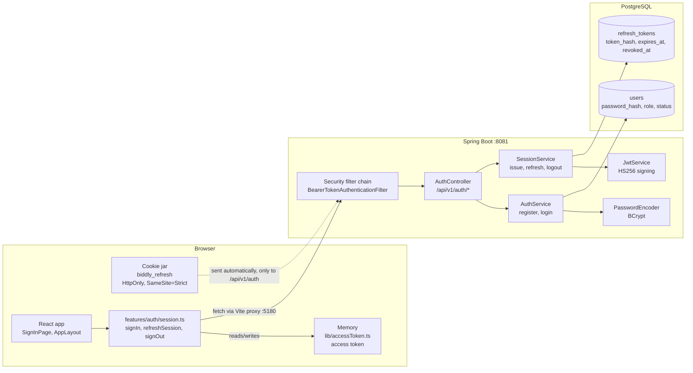
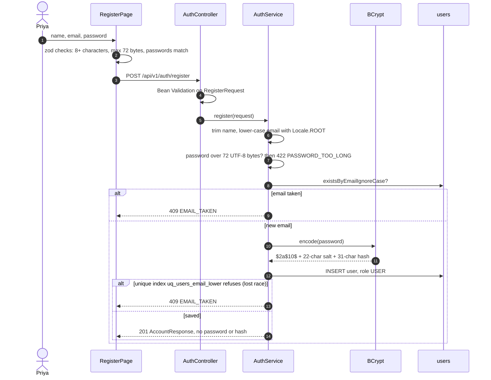
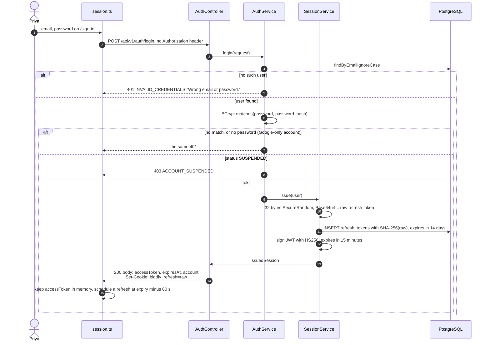
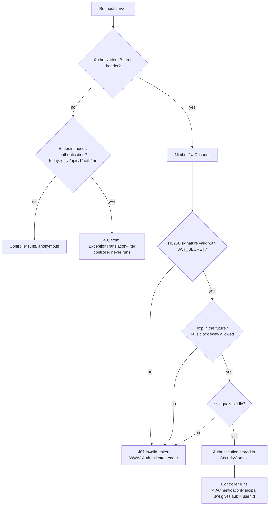
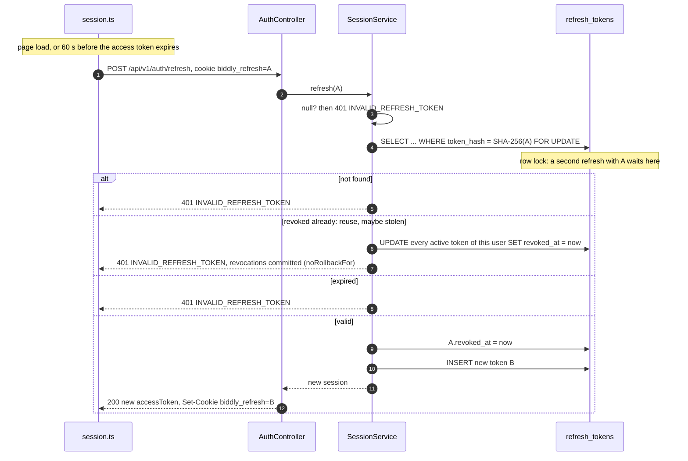
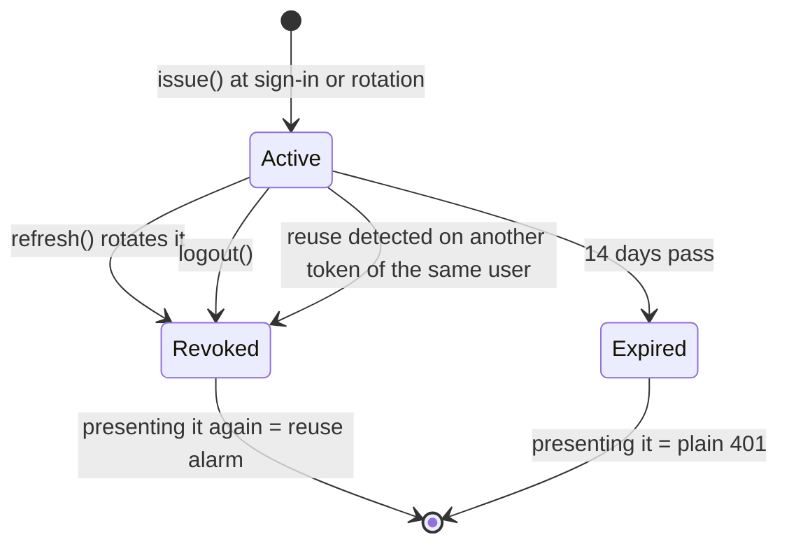
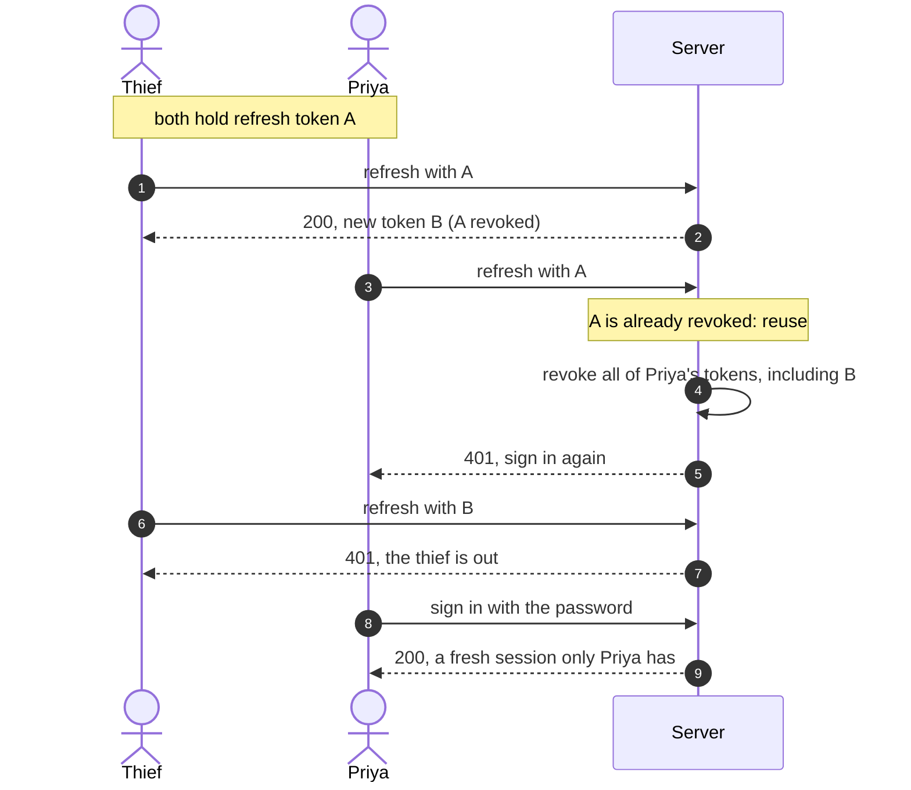
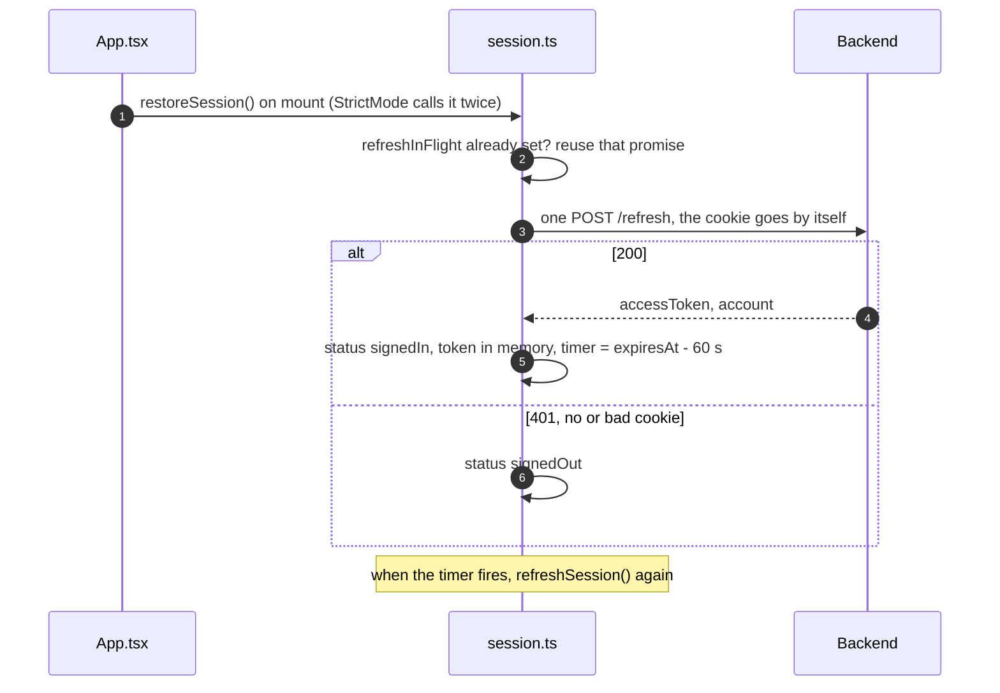
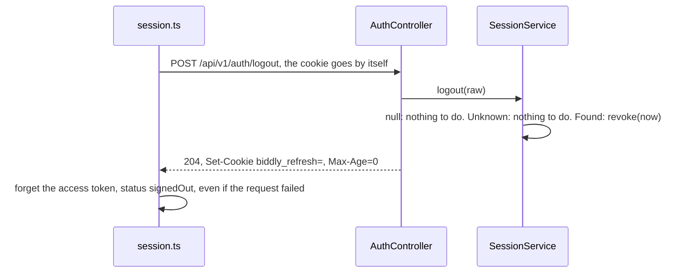

# Authentication and authorization in Biddly

How Biddly knows **who you are** (authentication) and **what you may do** (authorization), end to end.
This describes the code as it is, not the plan. Update it whenever a challenge changes the flow (see [Keeping this file up to date](#keeping-this-file-up-to-date)).

**Current state (Challenge 11b, 2026-11-24):**
- People can register, sign in, stay signed in and sign out.
- Only `GET /api/v1/auth/me` actually requires a signed-in user. Every other endpoint is still open, and the "Bid as" picker still decides who bids. Challenge 11c changes that.

For the *why* behind these ideas, read the [authentication primer](learning/authentication-primer.md) first.

---

## 1. At a glance

| What | Algorithm | Where | Stored as |
|---|---|---|---|
| Password | **BCrypt**, cost 10 (2^10 = 1,024 rounds of key setup), random 16-byte **salt** per hash | `SecurityConfig.passwordEncoder`, `AuthService` | `users.password_hash`, 60 characters, e.g. `$2a$10$...` |
| Access token | **JWT** signed with **HS256** (HMAC with SHA-256), 15 minutes | `JwtService`, `JwtConfig` | Nowhere on the server. The browser keeps it **in memory** |
| Signing key | A shared secret of at least 32 bytes (256 bits) | `JWT_SECRET` environment variable | Never in Git (dev and test use public dev-only keys) |
| Refresh token | 32 bytes from **`SecureRandom`**, encoded as **Base64url** (43 characters), 14 days | `SessionService.newRawToken` | Browser: `HttpOnly` cookie `biddly_refresh`. Server: only its **SHA-256** hash (64 hex characters) in `refresh_tokens.token_hash` |
| Token check on each request | Spring Security **OAuth 2 resource server**: Nimbus JOSE + JWT checks the signature, expiry and issuer | `SecurityConfig`, `JwtConfig.jwtDecoder` | - |

There's **no salt for refresh tokens** on purpose: they are already 256 random bits, and the same hash every time is what lets the server find a row by its hash (see [section 8](#8-why-bcrypt-for-passwords-but-sha-256-for-refresh-tokens)).

---

## 2. The big picture



Two tokens with two different jobs:

| | Access token | Refresh token |
|---|---|---|
| Proves | "I am user 7, role USER", for 15 minutes | "I may get a new access token", for 14 days |
| Format | JWT: readable by anyone, tamper-proof | Random string: means nothing by itself |
| Checked by | The signature, with the key. **No database** | A lookup of its hash in `refresh_tokens` |
| Sent | By our JavaScript, as `Authorization: Bearer ...` | By the browser, automatically, as a cookie |
| Stolen by an injected script? | Possible while the script runs, but it dies within 15 minutes | No: `HttpOnly` hides it from JavaScript |
| Can be cancelled early? | No, it's valid until it expires | Yes: set `revoked_at` |

---

## 3. Registration (Challenge 11a)



**What a BCrypt hash looks like:**

`$2a$10$fHxZO5tDTUbETKIiPv32k.kJuPKJCSjaDr4kxvIU95zgTlpiSnzci` (the dev seed's `biddly-demo`) splits into:

| Part | Value | Meaning |
|---|---|---|
| Version | `$2a$` | The BCrypt variant |
| Cost | `10$` | 2^10 = 1,024 rounds; each +1 doubles the time |
| Salt | `fHxZO5tDTUbETKIiPv32k.` | 22 characters = 16 random bytes, new for every `encode` |
| Hash | `kJuPKJCSjaDr4kxvIU95zgTlpiSnzci` | 31 characters, the result |

The salt is random and stored **inside** the hash, so:
- the same password gives a different hash each time;
- `matches(raw, hash)` reads the salt back out, hashes `raw` with it and compares;
- `encode(raw).equals(hash)` is **always false**. Never compare that way.

BCrypt only uses the first **72 bytes**. Spring Security 7's `encode` throws for longer input (a 500), so the service checks the bytes first (R28). `matches` just returns `false`.

---

## 4. Sign-in (Challenge 11b)



**Why the order matters:**
- The password is checked **before** the suspension. Otherwise "403 suspended" would confirm to someone with a *wrong* password that the account exists.
- The unknown-email, wrong-password and no-password cases share one 401 so nobody can tell which part was wrong (R28). Their *timing* still differs (see [section 10](#10-known-trade-offs)).

**The cookie:**

```text
Set-Cookie: biddly_refresh=<43 characters>; Path=/api/v1/auth; Max-Age=1209600; HttpOnly; SameSite=Strict; Secure
```

| Attribute | Effect |
|---|---|
| `HttpOnly` | JavaScript can't read it (`document.cookie` doesn't show it), so an injected script can't copy it |
| `SameSite=Strict` | The browser sends it only on requests that start on Biddly's own site. A form on `evil.com` arrives without it (stops CSRF) |
| `Path=/api/v1/auth` | Sent only to the auth endpoints, not with every auction request |
| `Max-Age=1209600` | 14 days, matching the server's `REFRESH_TOKEN_LIFETIME` |
| `Secure` | HTTPS only. Off in dev (`COOKIE_SECURE`), because dev runs on plain `http://localhost` |

---

## 5. Anatomy of the access token (JWT)

A JWT is three Base64url parts joined by dots: `header.payload.signature`.

```text
eyJ0eXAiOiJKV1QiLCJhbGciOiJIUzI1NiJ9 . eyJpc3MiOiJiaWRkbHkiLCJzdWIiOiI3Ii... . 3q2-7w...
```

| Part | Decoded | Notes |
|---|---|---|
| Header | `{"typ": "JWT", "alg": "HS256"}` | Which algorithm to verify with. The decoder accepts **only** HS256 |
| Payload | `{"iss": "biddly", "sub": "7", "iat": 1764000000, "exp": 1764000900, "name": "Priya Shah", "role": "USER"}` | Anyone can read this, so never put secrets here. `sub` is the user id |
| Signature | `HMAC-SHA256(base64url(header) + "." + base64url(payload), JWT_SECRET)` | Changing a single character of the payload makes the signature wrong |

**Signed, not encrypted.** Paste a token into <https://jwt.io>: you can read every claim without the key. What you can't do without the key is *change* a claim and still have a valid signature. `AuthSessionIntegrationTest.refusesAnAccessTokenWhosePayloadWasEdited` proves it.

**HS256 is symmetric:** the same secret signs and verifies. So:
- every backend copy behind a load balancer needs the **same** `JWT_SECRET`;
- anything that can verify tokens can also create them.

Google's ID tokens (Challenge 11d) use **RS256** instead, which is asymmetric: Google signs with a private key, and we verify with Google's public keys.

---

## 6. Every request with an access token

This is how `GET /api/v1/auth/me` works today, and how every protected endpoint will work after 11c.



**No database lookup** happens for the token itself: this is the "stateless" part. `/me` then loads the user by id, only to return the account details.

**Gotcha:**
- The filter checks a Bearer header on **every** endpoint, even open ones. An expired token sent to `/refresh` would get a 401 before `refresh` ever ran.
- That's why the frontend sends auth requests with `anonymous: true` (`lib/http.ts`), so no `Authorization` header goes with them.

**Today's 401s from the filter are not in our `ApiError` JSON shape.** `GlobalExceptionHandler` never sees them, because they happen before any controller. 11c adds a JSON entry point.

---

## 7. Refresh: rotation and reuse detection

### 7.1 A normal refresh



### 7.2 The life of one refresh-token row



A session leaves a **chain** of rows behind it: A (revoked), B (revoked), C (active), and so on. The rows are kept: they're what lets the server recognise an old token coming back.

### 7.3 Why reuse ends every session

A thief who copied token **A** and refreshes first gets **B**. When Priya later presents **A**, the server can't tell which of the two is the thief, so it ends both:



**`@Transactional(noRollbackFor = UnauthorizedException.class)`:**
- Without it, the 401 thrown after the revocations would roll them back, and **B** would keep working.
- Spring's default is to roll back on any unchecked exception (`RuntimeException`).

**Revoked is checked before expired**, so an old stolen token that's also expired still sets off the alarm.

---

## 8. Why BCrypt for passwords but SHA-256 for refresh tokens

| | Password | Refresh token |
|---|---|---|
| Chosen by | A human: guessable (`priya123`) | `SecureRandom`: 2^256 possibilities |
| Attack on a leaked hash | Try billions of likely passwords | Brute force: about 10^57 years at a trillion guesses per second |
| Hash | BCrypt, **slow on purpose** (about 100 ms), salted | SHA-256, fast, no salt |
| Found by | Email, then `matches` on one hash | `WHERE token_hash = SHA-256(raw)`, which only works because SHA-256 gives the same output every time |

The rule:
- **Low-entropy secrets** (chosen by people): use a slow, salted hash.
- **High-entropy secrets** (generated by machines): a fast hash is enough, and it's searchable.

---

## 9. In the browser

### 9.1 Page load, staying signed in, and the single-flight refresh



**Why only one refresh may run at a time:**
- Every refresh rotates the cookie. Two refreshes with the same cookie look exactly like theft (section 7.3).
- React's StrictMode runs effects twice in development, so without the single-flight check every page load would sign you out.

### 9.2 Where each piece lives in the browser

| Piece | Where | Survives a reload? | Readable by page JavaScript? |
|---|---|---|---|
| Access token | `lib/accessToken.ts` (a module variable) | No, so a reload refreshes | Yes, it must be, to set the header |
| Refresh token | Cookie jar | Yes, 14 days | **No** (`HttpOnly`) |
| Account details | `session.ts` state, read with `useAuth()` | No | Yes |
| Nothing | `localStorage` / `sessionStorage` | - | - |

`lib/http.ts` adds `Authorization: Bearer <token>` to every request **except** those marked `anonymous` (register, login, refresh and logout).

### 9.3 Sign-out



Sign-out **never fails**: with no valid session there is nothing to end.

**The already-issued access token still works until it expires**, at most 15 minutes. That's the price of stateless tokens; the frontend simply forgets it.

---

## 10. Known trade-offs

These are accepted for now and also recorded in [business-rules.md](business-rules.md).

| Trade-off | Why it's accepted | The fix, when it's worth it |
|---|---|---|
| Sign-up says `EMAIL_TAKEN`, revealing which emails have accounts | Biddly can't send email yet | Email verification: sign-up always says "check your inbox" |
| Sign-in **timing**: an unknown email answers in about 1 ms, a wrong password in about 100 ms | Sign-up already leaks the same thing | Run `matches` against a dummy hash when no user is found |
| Two **tabs** refreshing at the same moment look like theft, and both are signed out | Rare (it can happen after a laptop wakes up) | A short grace period after rotation, or tabs taking turns with the Web Locks API |
| An access token can't be cancelled before it expires | Short lifetime (15 minutes) | A deny list, at the cost of a lookup on every request |
| 401s from the security filter aren't in the `ApiError` JSON shape | Only `/me` is protected so far | Challenge 11c: a JSON `AuthenticationEntryPoint` |

---

## 11. Threats and what stops them

| Threat | Defence in Biddly |
|---|---|
| Database leak reveals passwords | Only BCrypt hashes, salted, cost 10 |
| Database leak reveals sessions | Only SHA-256 hashes of refresh tokens, so a stolen hash can't be used as a cookie |
| Injected script (XSS) steals a long-lived token | The refresh token is `HttpOnly`. The access token lives in memory only and dies within 15 minutes |
| Another site makes the browser call Biddly (CSRF) | `SameSite=Strict` on the cookie; every other endpoint uses a header that browsers never add by themselves |
| A user edits their JWT to become someone else | The HS256 signature fails, so 401 |
| An old token is replayed after rotation | Reuse detection ends every session of that user |
| Guessing which emails have accounts at sign-in | One message for every failure (but see the timing trade-off) |
| Passwords in logs | `RegisterRequest` and `LoginRequest` hide the password in `toString()`; `IssuedSession` hides its tokens |
| Signing key leaked through Git | `JWT_SECRET` comes from the environment; production has no default, and keys shorter than 32 bytes stop the app starting |

---

## 12. Authorization: what each user may do

| Rule | Today | Comes in |
|---|---|---|
| Must be signed in to see your account | ✅ `/api/v1/auth/me` needs a valid token | 11b |
| Must be signed in to create, edit, publish or cancel auctions, or to bid (R29) | ❌ Open. The request body says who the seller or bidder is | 11c |
| Only the owner may edit, publish or cancel an auction (R1) | ❌ Not checked against the token | 11c |
| Roles `USER` and `ADMIN` | Stored in `users.role` and put in the JWT's `role` claim, but **not enforced** anywhere yet | 11e |
| Only approved sellers create auctions (R32) | ❌ | 11e |
| A suspended account can't sign in | ✅ `403 ACCOUNT_SUSPENDED` | 11b |

**Authentication vs authorization:**
- **401 Unauthorized** really means "*unauthenticated*": we don't know who you are.
- **403 Forbidden** means "we know who you are, and you may not do this".

---

## 13. Where the code is

| Concern | Backend | Frontend |
|---|---|---|
| Security rules, BCrypt bean | `configuration/SecurityConfig.java` | - |
| JWT key, encoder and decoder | `configuration/JwtConfig.java` | - |
| Creating access tokens | `auth/JwtService.java` | - |
| Register and sign-in rules | `auth/AuthService.java` | `pages/RegisterPage.tsx`, `pages/SignInPage.tsx` |
| Sessions: issue, refresh, logout | `auth/SessionService.java`, `auth/RefreshToken.java`, `auth/RefreshTokenRepository.java`, `auth/TokenHasher.java` | `features/auth/session.ts` |
| Endpoints and the cookie | `auth/AuthController.java` | `features/auth/api.ts` |
| Sending the token | - | `lib/http.ts`, `lib/accessToken.ts` |
| Who is signed in | `@AuthenticationPrincipal Jwt` | `useAuth()` in `features/auth/hooks.ts` |
| Tables | `V4__add_user_role.sql`, `V5__create_refresh_tokens.sql` | - |
| Settings | `application.yml`: `biddly.auth.jwt.secret` (`JWT_SECRET`), `biddly.auth.cookie-secure` (`COOKIE_SECURE`) | `vite.config.ts` proxy |

---

## Keeping this file up to date

When a challenge changes authentication or authorization, update this file in the same change:

- **11c:** add the protected endpoints and the JSON 401/403 entry point to section 6 and section 12. Show the seller and bidder coming from `sub`, and the ownership check (R1).
- **11d:** add a "Sign in with Google" sequence diagram:
  - the ID token checks (RS256 with Google's JWKS keys, `iss`, `aud`, `exp`, `email_verified`);
  - matching on `sub`;
  - the `409 ACCOUNT_EXISTS` rule (R31);
  - add RS256 to section 1.
- **11e:** add the `ADMIN` URL rules and the seller-status state diagram (R32) to section 12.

Then change the "Current state" line at the top.

| Date | Change |
|---|---|
| 2026-11-24 | First version: registration (11a) and sign-in, tokens and sign-out (11b) |
