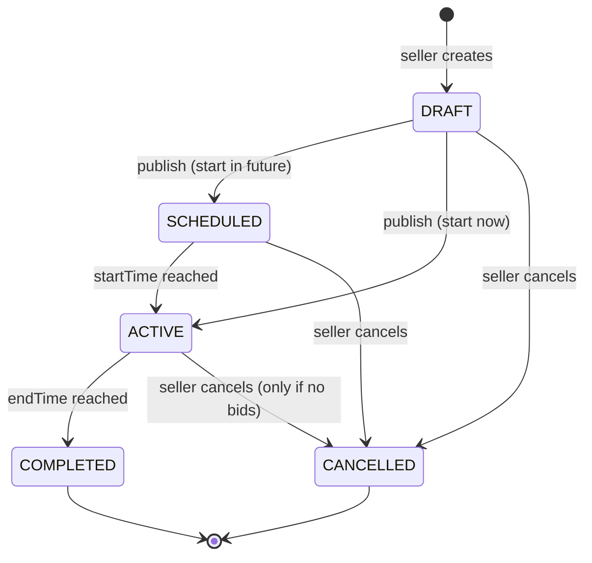

# Business rules

These rules matter more than the UI. Each one is enforced on the **server** (and in the database where possible). The UI only mirrors them to give fast feedback.

## Auction lifecycle



| # | Rule | Enforced by | Status |
|---|---|---|---|
| R1 | Only the auction owner can edit a draft | Service + auth (M5) | ⏳ |
| R2 | A published auction's price rules (starting price, increment) cannot change | `Auction.updateDetails` (Challenge 6, via R18) | ✅ |
| R3 | A seller cannot bid on their own auction | `Auction.acceptBid`, comparing user ids (Challenge 7) | ✅ |
| R4 | A bid must arrive before `endTime`, judged by the **server clock**. A bid at exactly `endTime` is too late | `Auction.acceptBid` with `now` from `BidService`'s `Clock` (Challenge 7) | ✅ |
| R5 | The first bid must be ≥ `startingPrice` (equal is allowed); every later bid must be ≥ `currentPrice + minimumIncrement`. "First" means `leadingBidder` is `null` | `Auction.acceptBid` (Challenge 7) | ✅ |
| R6 | Accepted bids can never be edited or deleted | `Bid` has no setters; no update/delete API. DB permissions later | 🟡 |
| R7 | A completed auction has at most one winning bid | `Auction.complete` keeps `leadingBidder` as the winner. It is a single column, so there can only be one (Challenge 9) | ✅ |
| R8 | An auction with no bids closes without a winner | `Auction.complete` leaves `leadingBidder` `null` (Challenge 9) | ✅ |
| R9 | All timestamps are stored in UTC | `TIMESTAMPTZ`, `Instant`, `hibernate.jdbc.time_zone=UTC` | ✅ |
| R10 | Cancellation is not allowed once valid bids exist | `Auction.cancel` (`AUCTION_HAS_BIDS`); a race with a first bid is caught by `@Version` (409) | ✅ |
| R11 | Money is exact decimal (`NUMERIC(12,2)`), never floating point | Schema + `BigDecimal` | ✅ |
| R12 | Prices and increments are positive; `end > start`; `current ≥ starting` | DB `CHECK` constraints | ✅ |
| R13 | A new auction starts in `DRAFT` with `currentPrice = startingPrice` | `Auction` constructor | ✅ |
| R14 | `startTime` must not be in the past; `endTime` must be after `startTime` | `AuctionService` (Challenge 2) | ✅ |
| R15 | Only a `DRAFT` can be published, and only while its `endTime` is still in the future | `Auction.publish` (Challenge 5) | ✅ |
| R16 | Publishing makes an auction `ACTIVE` if `startTime` has arrived, otherwise `SCHEDULED` | `Auction.publish` (Challenge 5) | ✅ |
| R17 | A `COMPLETED` or `CANCELLED` auction can't be cancelled | `Auction.cancel` (Challenge 5) | ✅ |
| R18 | Only a `DRAFT` can be edited. An edit re-checks R14 and resets `currentPrice` to the new `startingPrice` | `AuctionService.updateAuction`, `Auction.updateDetails` (Challenge 6) | ✅ |
| R19 | Only an `ACTIVE` auction accepts bids. Checks run in a fixed order (not active, closed, self-bid, too low) so the user sees the most basic problem first | `Auction.acceptBid` (Challenge 7) | ✅ |
| R20 | A rejected bid is never stored; an accepted bid, the new price and the new leader are saved in one transaction | `BidService.placeBid` (`@Transactional`) (Challenge 7) | ✅ |
| R21 | When bids race, exactly one wins. The others get a clear answer (`409 CONCURRENT_UPDATE` or `422 BID_TOO_LOW`), never a `500` | `@Version` on `Auction`, `GlobalExceptionHandler`, `SELECT ... FOR UPDATE` in `placeBid` (Challenge 8) | ✅ |
| R22 | Auctions move on time without anyone clicking: `SCHEDULED` → `ACTIVE` once `startTime` arrives, `ACTIVE` → `COMPLETED` once `endTime` arrives. Only these two moves happen automatically; `DRAFT` and `CANCELLED` are never touched | `Auction.start`, `Auction.complete`, `AuctionLifecycleService.advance`, run every 5 s by `AuctionLifecycleJob` (Challenge 9) | ✅ |
| R23 | A repeated bid request (same bidder, same `Idempotency-Key`) never places a second bid. The same auction and amount get the original bid back; anything else gets `422 IDEMPOTENCY_KEY_REUSED` | `BidService.placeBid`, unique index on `bids (bidder_id, idempotency_key)` (Challenge 10) | ✅ |
| R24 | An auction lasts at least 10 minutes and at most 4 months (120 days) | `AuctionService.validateTimeWindow` (`AUCTION_TOO_SHORT`, `AUCTION_TOO_LONG`); the auction form checks it too | ✅ |
| R25 | Money is in whole rupees: starting price, increment and bid amount have no paise | `@WholeRupees` on the request DTOs (400, "must be in whole rupees"); the UI inputs step by ₹1 | ✅ |
| R26 | The current leader may raise their own bid; the usual minimum (current price + increment) applies | `Auction.acceptBid` (no leader check), `AuctionTest.letsTheLeaderRaiseTheirOwnBid` | ✅ |

## Concurrency: the most important scenario

The current bid is ₹1,000. Two people bid ₹1,100 and ₹1,200 at the same instant. This must **never** happen:

```
Request A reads current = 1000      Request B reads current = 1000
A validates 1100 > 1000 ✔          B validates 1200 > 1000 ✔
A writes current = 1100             B writes current = 1200
→ both "accepted", history and price may disagree
```

The plan for Milestone 6: inside one database transaction, **lock or version** the auction row, re-read the price, validate, insert the bid, update the price, commit, and only then publish the update. You will compare `SELECT ... FOR UPDATE` (pessimistic) with `@Version` (optimistic).

**Decided in Challenge 8 (2026-11-12): both, in layers.**

- **Bids take a pessimistic lock.** `placeBid` loads the auction with `AuctionRepository.findByIdForUpdate` (`SELECT ... FOR UPDATE`). Bids on one auction queue up in arrival order, and each is judged against the previous winner's price. The losers get `422 BID_TOO_LOW` with the new minimum. This is the right fit for many bidders on one row, such as the last seconds of a popular auction.
- **`@Version` stays as the safety net** for every writer that doesn't take the lock: draft edits, cancel, and the future scheduler. When it fires, `GlobalExceptionHandler` answers `409 CONCURRENT_UPDATE` instead of a 500.
- **Keep the locked transaction short.** It holds the row lock and a database connection. Slow side effects (emails, notifications, WebSocket pushes) run **after commit**, never inside `placeBid`.
- `BidConcurrencyIntegrationTest` proves it: 8 simultaneous bids give one winner, seven 422s, no 409s and no 500s, and the price, the leader and the history agree.

## Product decisions

All six open questions are decided. Revisit them here if the product changes.

1. **First bid:** must it be ≥ `startingPrice`, or ≥ `startingPrice + minimumIncrement`?
   **Decided (2026-10-30): ≥ `startingPrice`.** A first bid equal to the starting price is valid, because the seller already said they would sell at that price. The increment applies only once there is a bid to beat. See R5.
2. **Anti-sniping:** if a bid arrives in the last 2 minutes, should `endTime` be extended (as eBay-style "soft close" does)?
   **Decided (2026-11-16): no, not for now.** The end time is fixed once published. Revisit if last-second bids become a complaint.
3. **Self-outbidding:** may the current highest bidder raise their own bid?
   **Decided (2026-11-16): yes** (R26). The usual minimum applies: current price + increment. `acceptBid` already allows it; `AuctionTest.letsTheLeaderRaiseTheirOwnBid` locks it in.
4. **Reserve price:** should sellers be able to set a hidden minimum below which the item isn't sold?
   **Decided (2026-11-16): no.** The starting price is the only minimum, and it's visible to everyone.
5. **Duration limits:** minimum and maximum auction length?
   **Decided (2026-11-16): at least 10 minutes, at most 4 months** (R24). "4 months" is counted as 120 days, because the server works in UTC `Instant`s and calendar months vary in length.
6. **Increment rounding:** should a bid of ₹1,100.50 be allowed, or only whole rupees?
   **Decided (2026-11-16): whole rupees only** (R25), for bids, starting prices and increments. The `NUMERIC(12, 2)` columns stay, so paise could be allowed again later without a migration.
