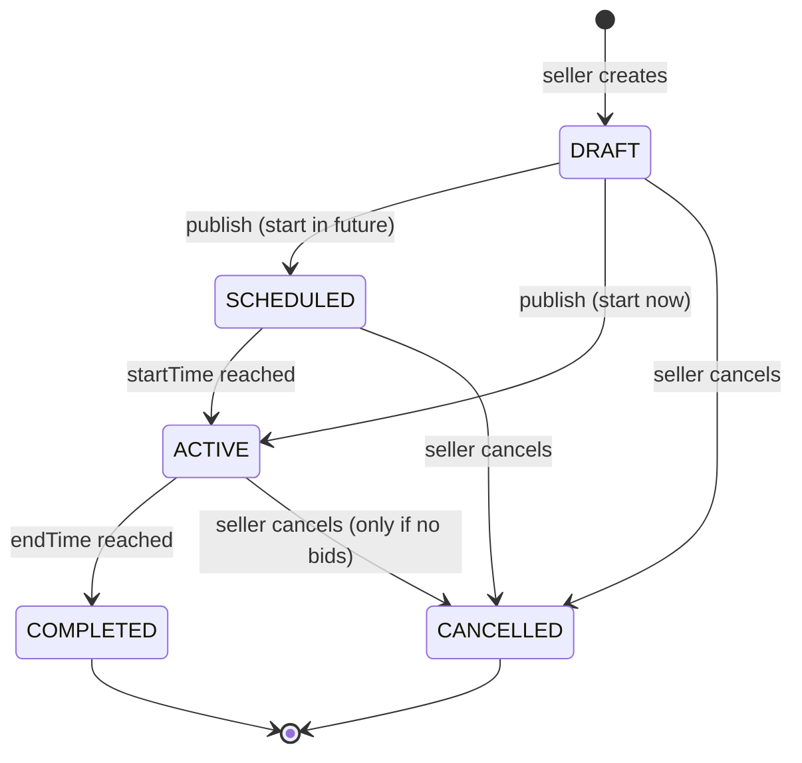

# Business rules

These rules matter more than the UI. Each one is enforced on the **server** (and in the database where possible). The UI only mirrors them to give fast feedback.

## Auction lifecycle



| # | Rule | Enforced by | Status |
|---|---|---|---|
| R1 | Only the auction owner can edit a draft | Service + auth (M5) | ⏳ |
| R2 | A published auction's price rules (starting price, increment) cannot change | Service | ⏳ |
| R3 | A seller cannot bid on their own auction | Service (M6) | ⏳ |
| R4 | A bid must arrive before `endTime`, judged by the **server clock** | Service (M6) | ⏳ |
| R5 | A bid must be ≥ `currentPrice + minimumIncrement` | Service (M6) | ⏳ |
| R6 | Accepted bids can never be edited or deleted | No update/delete API; DB permissions | ⏳ |
| R7 | A completed auction has at most one winning bid | Service + partial unique index (M6) | ⏳ |
| R8 | An auction with no bids closes without a winner | Scheduler (M7) | ⏳ |
| R9 | All timestamps are stored in UTC | `TIMESTAMPTZ`, `Instant`, `hibernate.jdbc.time_zone=UTC` | ✅ |
| R10 | Cancellation is not allowed once valid bids exist | Service | ⏳ |
| R11 | Money is exact decimal (`NUMERIC(12,2)`), never floating point | Schema + `BigDecimal` | ✅ |
| R12 | Prices and increments are positive; `end > start`; `current ≥ starting` | DB `CHECK` constraints | ✅ |
| R13 | A new auction starts in `DRAFT` with `currentPrice = startingPrice` | `Auction` constructor | ✅ |
| R14 | `startTime` must not be in the past; `endTime` must be after `startTime` | `AuctionService` (Challenge 2) | 🟡 |

## Concurrency: the most important scenario

The current bid is ₹1,000. Two people bid ₹1,100 and ₹1,200 at the same instant. This must **never** happen:

```
Request A reads current = 1000      Request B reads current = 1000
A validates 1100 > 1000 ✔          B validates 1200 > 1000 ✔
A writes current = 1100             B writes current = 1200
→ both "accepted", history and price may disagree
```

The plan for Milestone 6: inside one database transaction, **lock or version** the auction row, re-read the price, validate, insert the bid, update the price, commit, and only then publish the update. You will compare `SELECT ... FOR UPDATE` (pessimistic) with `@Version` (optimistic).

## Open questions for you

Decide these before Milestone 6, and write your answers here with your reasoning:

1. **First bid:** must it be ≥ `startingPrice`, or ≥ `startingPrice + minimumIncrement`?
2. **Anti-sniping:** if a bid arrives in the last 2 minutes, should `endTime` be extended (as eBay-style "soft close" does)? By how much?
3. **Self-outbidding:** may the current highest bidder raise their own bid?
4. **Reserve price:** should sellers be able to set a hidden minimum below which the item isn't sold?
5. **Duration limits:** minimum and maximum auction length?
6. **Increment rounding:** should a bid of ₹1,100.50 be allowed, or only whole rupees?
