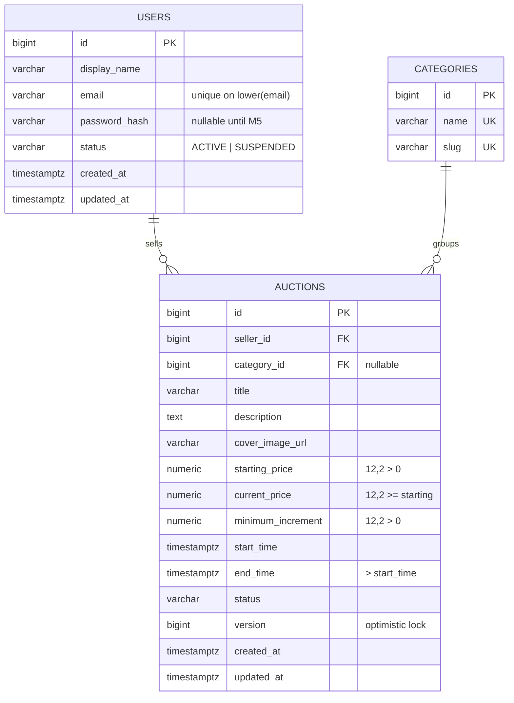

# Database design

PostgreSQL is the **source of truth**. Schema changes are made only through Flyway migrations in `backend/src/main/resources/db/migration`.

## Current schema (V1)

### Constraints and indexes

| Name | Purpose |
|---|---|
| `uq_users_email_lower` | One account per email, case-insensitive |
| `ck_auctions_*` | Positive money, `current ≥ starting`, `end > start`, valid status |
| `idx_auctions_status_end_time` | "Active auctions ordered by end time", the home page query and the auto-close job |
| `idx_auctions_category_status` | Category filter |
| `idx_auctions_seller` | "My auctions" and the foreign-key lookup |

## Planned tables

| Table | Milestone | Notes |
|---|---|---|
| `roles`, `user_roles` | M5 | BIDDER, SELLER, ADMIN |
| `refresh_tokens` | M5 | Store a hash, never the raw token |
| `bids` | M6 | `auction_id, bidder_id, amount, status, created_at`; index `(auction_id, amount DESC)`; insert-only |
| `idempotency_keys` | M6 | Or Redis with a TTL |
| `watchlist` | M7 | Composite PK `(user_id, auction_id)` |
| `notifications` | M7 | `read_at` nullable |
| `audit_events` | M8 | `metadata JSONB` |
| `auction_images` | Later | Replaces `cover_image_url` when upload exists |

## Conventions

- Table names are plural and snake_case; columns are snake_case (Hibernate maps `startTime` → `start_time` automatically).
- Every table has `id BIGINT GENERATED ALWAYS AS IDENTITY`.
- Money is `NUMERIC(12,2)` (up to ₹9,99,99,99,999.99).
- Time is `TIMESTAMPTZ`. PostgreSQL stores UTC internally.
- Name every constraint (`ck_`, `uq_`, `fk_`, `idx_`) so error messages and migrations are readable.
- Migration files are **immutable** once applied. Fixes go in a new `V{n+1}__...sql`.
