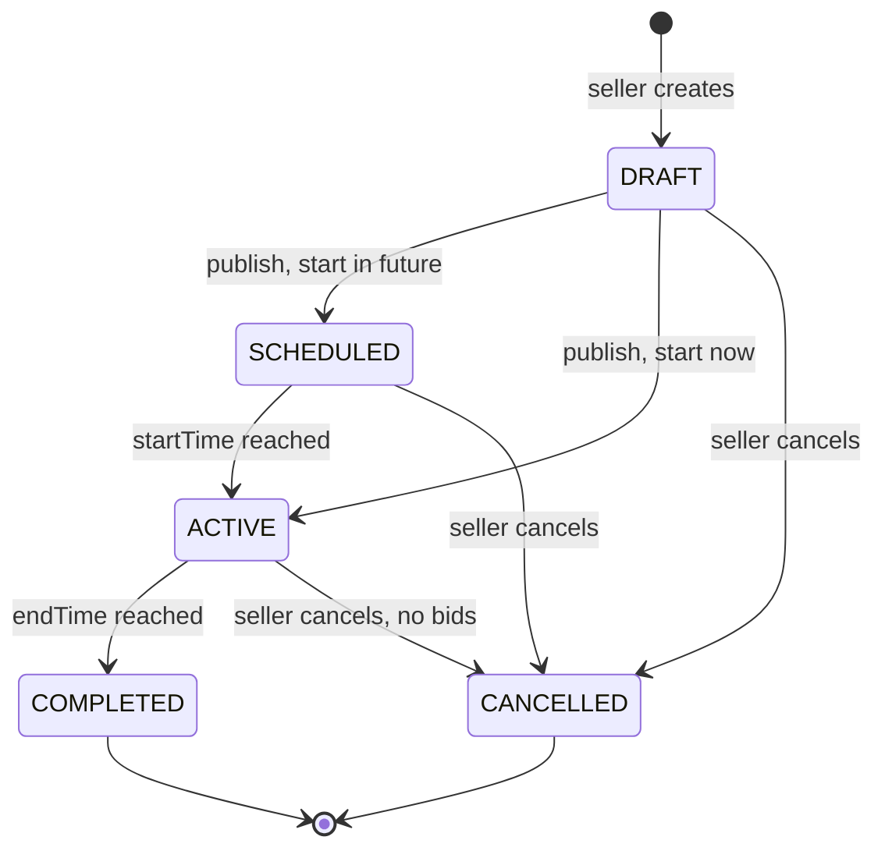

# Biddly - Product Requirements Document

## 1. Document info

- **Product:** Biddly, a live auction web app
- **Owner:** [@Samijain](https://github.com/Samijain) (product and engineering)
- **Version:** 1.0
- **Last updated:** 2026-10-29
- **Status:** Approved for MVP. Milestones 0-3 done; Milestone 4 in progress (create done; edit, publish and cancel open)
- **Related docs:** [User stories](user-stories.md) · [Business rules](business-rules.md) · [Architecture](architecture.md) · [Database design](database-design.md) · [Roadmap](ROADMAP.md)

---

## 2. Project purpose

### Problem

- Online auctions break in the last few seconds, when many people bid at almost the same moment.
- If a system reads the price, checks it and saves it without protection, two bids can both be "accepted". The bid history and the final price then disagree, and the winner is unclear.
- Bidders also need to see the current price immediately. If they don't, they bid against a price that is already out of date.

### Vision

Biddly is a real-time auction marketplace. Sellers create timed auctions, and registered bidders compete until the auction closes. Every accepted bid is recorded permanently, and each auction ends with at most one winner.

### The core engineering problem

Many users may bid on the same item at almost the same moment. Biddly must accept only valid bids, keep them in the correct order, and declare exactly one winner. Everything else is built around this guarantee.

### Goals

- **Correct bidding:** the server is the single source of truth for price, time and winner.
- **Live experience:** price changes reach everyone watching an auction in under a second.
- **Easy to use:** a modern, mobile-first interface that a first-time user understands without help.
- **Cloud-ready:** containerized, tested in CI, and deployable to Kubernetes with a managed database.
- **Portfolio quality:** clean architecture, documented decisions and automated tests that a reviewer can follow.

### Success metrics

- Zero inconsistent auctions in the concurrency test (for example, 100 simultaneous bids on one auction).
- A bid is accepted or rejected in under 300 ms (p95) locally.
- A price update reaches other viewers in under 1 s once WebSocket is in place.
- Every rejected bid shows the user a clear reason.
- A new developer can start the whole stack with one command.

---

## 3. Target users and personas

| Role | Can |
|---|---|
| **Visitor** | Browse and search auctions, view details and bid history |
| **Bidder** | Everything a visitor can do, plus place bids, watch auctions, get outbid/won notifications, and see their bids and wins |
| **Seller** | Create, edit (draft only), publish and cancel their own auctions; see the winner |
| **Administrator** | Manage users, review reported auctions, suspend accounts, view the audit history |

- A user can be both a bidder and a seller, but never bids on their own auction.
- **Example personas:**
  - *Priya, bidder:* a collector browsing on her phone in the evening. She wants to know instantly whether she is winning.
  - *Arjun, seller:* sells a few used gadgets a month. He wants to list an item in under two minutes and be told who won.
  - *Meera, administrator:* moderates the marketplace. She needs to suspend bad actors and trace what happened in a disputed auction.

---

## 4. User stories

Format: *As a [role], I want [goal] so that [benefit].* Full acceptance criteria (AC) are in [user-stories.md](user-stories.md). The milestone (M) that delivers each story is shown in brackets.

In a task-list app, the basic actions are adding a task, editing it and marking it done. In Biddly, the matching actions are creating an auction, editing a draft, and publishing, closing or cancelling it.

### Selling: create, edit and finish auctions

- **US-10 Create a draft auction** [M4]: As a seller, I want to create an auction with a title, description, image, category, starting price, minimum increment and time window, so that I can sell an item.
  - AC: The auction is saved as `DRAFT`, with `currentPrice = startingPrice`.
  - AC: Invalid input (a start time in the past, an end time before the start, a price of zero or less) shows a message next to the right field.
- **US-13 Edit a draft auction** [M4]: As a seller, I want to change my draft before publishing, so that I can fix mistakes.
  - AC: Only the owner can edit (R1), and only while the auction is in `DRAFT`.
  - AC: Once published, the starting price and increment are locked (R2).
- **US-11 Publish an auction** [M4]: As a seller, I want to publish my draft, so that bidders can see it.
  - AC: It becomes `ACTIVE` if the start time is now, or `SCHEDULED` if the start time is in the future.
- **US-12 Cancel an auction** [M4]: As a seller, I want to cancel my auction before anyone has bid.
  - AC: Cancelling is blocked once a valid bid exists (R10).
- **US-14 See the result** [M7]: As a seller, I want to see when my auction has closed and who won, so that I can complete the sale.
  - AC: The auction moves to `COMPLETED` automatically at the end time, with one winner (R7) or no winner if nobody bid (R8).

### Bidding

- **US-20 Place a bid** [M6]: As a bidder, I want to place a bid and get an immediate yes or no answer with the reason, so that I know where I stand.
  - AC: Rejection codes are `AUCTION_NOT_ACTIVE`, `AUCTION_CLOSED`, `SELF_BIDDING_NOT_ALLOWED` and `BID_TOO_LOW`.
  - AC: When bids race, exactly one wins and the others get a clear answer (`422` or `409`), never a `500`.
  - AC: Double-clicking "Place bid" never creates two bids (idempotency key).
- **US-21 See live price changes** [M7]: As a bidder, I want the price to update without refreshing, so that I can react to competing bids.
- **US-22 Outbid notification** [M7]: As a bidder, I want to be told when I've been outbid.
- **US-23 Win an auction** [M7]: As a bidder, I want to know when I've won and see it in "My wins".
- **US-24 My bids** [M6]: As a bidder, I want a list of auctions I've bid on, showing whether I'm currently winning, so that I can follow them in one place.
- **US-25 Watch an auction** [M7]: As a bidder, I want to save auctions to a watchlist, so that I can come back before they end.

### Browsing

- **US-01 Browse live auctions** [M0, done]: As a visitor, I want to see all active auctions, so that I can find something to bid on.
- **US-02 Search and filter** [M3]: As a visitor, I want to search by keyword, filter by category and change the sort order, so that I quickly find relevant items.
- **US-03 View auction details** [M0, done]: As a visitor, I want to see the full description, the price rules and the closing time, so that I can decide whether to bid.
- **US-04 View bid history** [M6]: As a visitor, I want to see every accepted bid in order, so that I can trust the auction is fair.

### Accounts

- **US-30 Register, sign in and sign out** [M5]
- **US-31 Protected pages redirect to sign-in** [M5]

### Administration

- **US-40 Suspend a user** [post-MVP]
- **US-41 View audit history** [post-MVP]
- **US-42 Review reported auctions** [post-MVP]: As an administrator, I want to review auctions that users have reported, so that I can remove fraudulent listings.

---

## 5. Key features

### 5.1 Creating auctions and the auction lifecycle [M4]

- Sellers create an auction as a draft, edit it, then publish it.
- Every auction moves through a fixed set of states, and only the server changes them:

- **Rules:**
  - A new auction starts in `DRAFT` (R13).
  - The start time must not be in the past, and the end time must be after the start (R14).
  - Only the owner can edit a draft (R1), and price rules are locked after publishing (R2).
  - An auction can't be cancelled once it has bids (R10).
- **API:** `POST /api/v1/auctions` (Challenge 2), then endpoints for edit, publish and cancel.
- **UI:** a "Sell an item" form with field-level validation (React Hook Form with Zod).

### 5.2 Bidding on open auctions [M6]

- Signed-in bidders can bid on `ACTIVE` auctions they don't own.
- **Validation:**
  - The seller can't bid on their own auction (R3).
  - A bid must arrive before the end time, as judged by the server clock (R4).
  - The first bid must be at least `startingPrice`, so a bid equal to the starting price is accepted. Every later bid must be at least `currentPrice + minimumIncrement` (R5).
- **Consistency:** each bid runs in one database transaction. The transaction locks or versions the auction row, re-reads the price, validates the bid, inserts it, updates the price and commits. Both pessimistic (`SELECT ... FOR UPDATE`) and optimistic (`@Version`) locking will be compared.
- **Idempotency:** each "Place bid" click sends a client-generated key, so a retry or double-click never creates a duplicate bid.
- **One winner:** a completed auction has at most one winning bid (R7). This is enforced by the service and by a partial unique index.
- **Immutable history:** accepted bids can never be edited or deleted (R6).
- **UI:** a bid panel that suggests the minimum valid amount and shows the server's accept or reject reason inline.

### 5.3 Data persistence in a database [M0 onward]

- **PostgreSQL** is the single source of truth for users, categories, auctions and bids.
- **Flyway migrations:** every schema change is a versioned SQL file. Hibernate only validates the schema (`ddl-auto: validate`) and never changes it.
- **Money:** stored as `NUMERIC(12,2)` and handled as `BigDecimal`, never as floating point (R11).
- **Time:** stored as `TIMESTAMPTZ` in UTC and shown in the viewer's local time (R9).
- **Integrity in the database itself:**
  - `CHECK` constraints keep prices positive and require `end > start` and `current >= starting` (R12).
  - Foreign keys link auctions to sellers and categories, and indexes support listing by status and end time.
- **Seed data:** sample data loads only in the `dev` profile and never in production.
- **In the cloud:** a managed PostgreSQL service handles backups, upgrades and failover.
- See [database-design.md](database-design.md) for the schema.

### 5.4 Real-time updates [M7]

- Polling every 5-10 seconds is used for now (TanStack Query).
- WebSocket (STOMP) pushes `BID_ACCEPTED` and `AUCTION_CLOSED` events to everyone viewing an auction.
- Redis pub/sub fans out events across multiple backend replicas.
- Events are published only after the bid transaction commits, so viewers never see a bid that was rolled back.

### 5.5 Automatic auction closing [M7]

- A scheduler moves `SCHEDULED` auctions to `ACTIVE` at the start time, and `ACTIVE` auctions to `COMPLETED` at the end time.
- It records the winner, or no winner if nobody bid (R8).
- It is safe to run on several replicas: each auction is closed exactly once.

### 5.6 Authentication and authorization [M5]

- Users register and sign in with an email address and password. Passwords are hashed with BCrypt.
- Short-lived JWT access tokens, plus a refresh token in an HttpOnly cookie.
- Roles (`BIDDER`, `SELLER`, `ADMIN`) and ownership checks are applied on every write endpoint.
- Protected pages redirect to sign-in (US-31).

### 5.7 Search, filtering and notifications [M3, M7]

- Keyword search, category filters, and sorting by ending soon, newest or price (Challenge 3).
- Paginated results (`page`, `size`) from the API.
- In-app notifications for being outbid, winning, and your auction closing.

---

## 6. Scope

### MVP scope

1. Registration and sign-in
2. Bidder and seller roles
3. Create and edit a draft auction
4. Publish an auction
5. List, search, sort and filter active auctions
6. View auction details
7. Place a valid bid; reject an invalid bid with a clear reason
8. Close expired auctions automatically and identify the winner
9. Bid history
10. Docker Compose setup, automated tests, GitHub Actions CI

### Out of scope for the MVP

- Real payments (they will be simulated)
- Microservices and Kafka
- Autoscaling
- Recommendations
- Native mobile apps

---

## 7. Non-functional requirements

### Correctness and consistency

- Zero inconsistent auctions under concurrent bidding, proven by an automated concurrency test.
- The server clock decides whether a bid is on time; the client clock is never trusted.
- Business rules are enforced on the server and, where possible, in the database. The UI only mirrors them to give fast feedback.

### Performance

- A bid is accepted or rejected in under 300 ms (p95) locally.
- Price updates reach other viewers in under 1 s once WebSocket is in place.
- Auction list pages load in under 1 s on a typical broadband connection. Lists are paginated, with no unbounded queries.

### Scalability

- The backend is stateless, so more replicas can be added behind the Ingress.
- Shared state lives in PostgreSQL and Redis, never in application memory.

### Security

- OWASP basics: hashed passwords, an HttpOnly refresh cookie, role and ownership checks, and server-side input validation.
- Rate limiting on sign-in and bidding endpoints.
- No secrets in Git. Configuration comes from environment variables or Kubernetes Secrets.
- HTTPS in every deployed environment, and CORS restricted to the frontend origin.

### Reliability and availability

- Liveness and readiness health probes for Kubernetes.
- Database changes only through Flyway migrations, so every environment has the same schema.
- Managed PostgreSQL with automated backups in the cloud.

### Usability and accessibility

- A mobile-first responsive UI with light and dark themes.
- Keyboard accessible, aiming for WCAG 2.1 AA (contrast, focus states, labels).
- Clear error messages next to the field or action that caused them.
- Skeleton loaders while data loads, and a friendly message when the server is unreachable.
- Prices in INR (₹) with `en-IN` formatting, and times in the viewer's local time zone.

### Observability

- Structured (JSON) logs that include a request ID.
- Metrics through Spring Boot Actuator.
- Every error returns the same `ApiError` JSON shape.

### Maintainability and testing

- A modular monolith with modules split by business capability (see [architecture.md](architecture.md)).
- Unit tests for business rules, Testcontainers integration tests against real PostgreSQL, frontend tests with Vitest, and end-to-end tests with Playwright.
- CI runs lint, type checks and all tests on every pull request.

### Portability

- 12-factor configuration: the same container image runs in Docker Compose, Kubernetes and the cloud.
- One-command local start (`docker compose up`).

---

## 8. Tech stack

### Frontend

- React 19 and TypeScript 6, built with Vite 8
- MUI 9 design system (light and dark themes, Inter font)
- TanStack Query for server state, caching and polling
- React Router for navigation
- React Hook Form with Zod for forms and validation

### Backend

- Java 21 with Spring Boot 4.1
- Spring Web MVC (REST API under `/api/v1`), Spring Data JPA, Bean Validation
- Spring Security with JWT [M5]
- Spring WebSocket (STOMP) [M7]
- Spring Boot Actuator for health and metrics
- Flyway for database migrations

### Data

- PostgreSQL 17 as the source of truth
- Redis for caching, rate limiting and pub/sub [M7]

### Testing

- Backend: JUnit 5, Mockito, Testcontainers
- Frontend: Vitest and Testing Library
- End to end: Playwright [M8]

### Infrastructure and delivery

- Docker and Docker Compose for local development, with multi-stage images [M9]
- GitHub Actions for CI and image publishing [M10]
- Kubernetes: Deployments, Services, Ingress, ConfigMaps, Secrets and HPA [M11]
- Cloud hosting with managed PostgreSQL, HTTPS and a custom domain [M12]

---

## 9. Assumptions, risks and open questions

### Assumptions

- Payments are simulated; no real money changes hands in the MVP.
- There is one currency (INR) and one marketplace region.
- Bidders accept that the server clock, not their own device, decides when an auction ends.

### Risks

- **Race conditions in bidding.** *Mitigation:* row locking or versioning, plus a concurrency test in CI.
- **Bid sniping** in the last seconds, which can feel unfair. *Mitigation:* consider a soft close (see the open questions).
- **WebSocket complexity across replicas.** *Mitigation:* Redis pub/sub, with polling as a fallback.
- **Cloud cost** for a portfolio project. *Mitigation:* small instance sizes and a managed free tier where possible.

### Open questions

These are tracked, with your reasoning, in [business-rules.md](business-rules.md#open-questions-for-you). Decide them before Milestone 6:

1. ~~Must the first bid be at least `startingPrice`, or at least `startingPrice + minimumIncrement`?~~ **Decided:** at least `startingPrice` (R5).
2. Anti-sniping: should a late bid extend the end time, and by how much?
3. May the current highest bidder raise their own bid?
4. Should sellers be able to set a hidden reserve price?
5. What are the minimum and maximum auction durations?
6. Are paise allowed in bids, or only whole rupees?

---

## 10. Release plan

| Phase | Milestones | Outcome |
|---|---|---|
| Foundation | M0-M2 ✅ | Repository, read-only slice, JavaScript and TypeScript domain exercises |
| Core product | M3-M6 | Browsing UI, creating auctions, authentication, bidding engine |
| Live experience | M7-M8 | Real-time updates, auto-close, notifications, tests and observability |
| Ship it | M9-M12 | Docker images, CI, Kubernetes, cloud deployment |

Status for each milestone is in [ROADMAP.md](ROADMAP.md).
